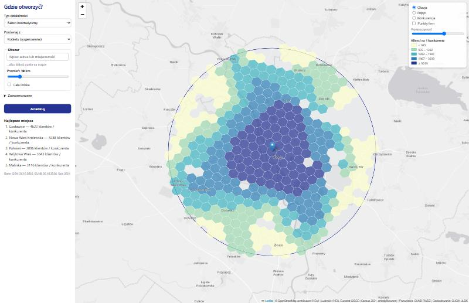
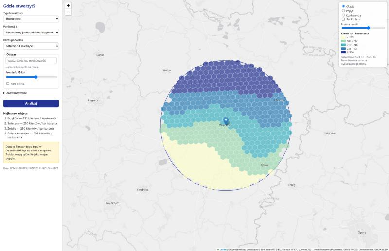
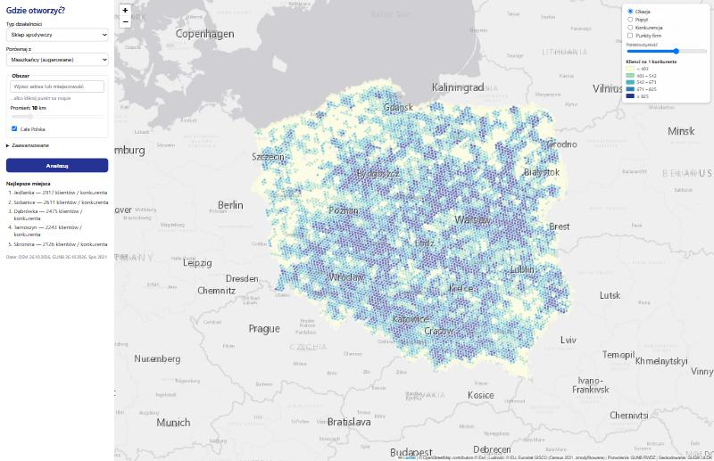

# Gdzie otworzyć? — mapa okazji biznesowych

Aplikacja webowa, która na mapie Polski pokazuje, **gdzie jest dużo potencjalnych klientów i mało konkurencji**. Projekt zaliczeniowy z przedmiotu „Analiza danych przestrzennych”.

Wybierasz typ działalności (16 typów), czynnik popytu (ludność ze spisu 2021 albo nowe domy z pozwoleń na budowę) i obszar (adres/klik + promień albo cała Polska). W odpowiedzi dostajesz heatmapę **„klienci na 1 konkurenta”**, listę 5 najlepszych miejsc i szczegóły po kliknięciu w heksagon.



## Przykłady użycia

- **Salon kosmetyczny**: typ „Salon kosmetyczny”, popyt „Kobiety”, punkt w Opolu, promień 10 km → ciemne heksagony to miejsca z dużą liczbą kobiet w zasięgu 1,5 km i małą liczbą salonów w OpenStreetMap.
- **Brukarz**: typ „Brukarstwo”, popyt „Nowe domy jednorodzinne” (ostatnie 24 miesiące), okolice Wrocławia 30 km → skupiska nowo wydawanych pozwoleń na domy, gdzie ludzie będą potrzebować kostki brukowej.
- **Sklep spożywczy w skali kraju**: „Cała Polska” → mapa w heksagonach ~5,6 km.

| Brukarz pod Wrocławiem | Cała Polska |
|---|---|
|  |  |

## Jak to działa (metoda)

Dla każdego heksagonu *i* siatki H3 liczymy dwie sumy z wagą malejącą z odległością (**estymacja jądrowa, KDE**; uproszczony model dostępności typu 2SFCA):

```
D_i = Σ_j d_j · K(odległość_ij)      popyt w zasięgu   (d_j = np. liczba kobiet w heksagonie j)
S_i = Σ_j s_j · K(odległość_ij)      konkurencja w zasięgu (s_j = liczba firm danego typu w heksagonie j)
K(d) = exp(−d² / (2h²))              jądro Gaussa, obcięte dla d > 3h

wynik_i = D_i / (S_i + 1)            „klienci na 1 konkurenta”
```

`h` to szerokość pasma — „zasięg klienta” (np. 1,5 km dla salonu, 15 km dla marketu budowlanego); można ją zmienić suwakiem. „+1” zapobiega dzieleniu przez zero.

Najważniejsze decyzje metodyczne (szczegółowo w [docs/sciaga-do-obrony.md](docs/sciaga-do-obrony.md)):

- **Siatka H3** (heksagony) w rozdzielczościach 8 → 7 → 6, zależnie od wielkości obszaru; unikamy zależności wyniku od granic administracyjnych (MAUP).
- **Interpolacja powierzchniowa**: ludność ze spisu (kwadraty 1 km, EPSG:3035) rozkładamy na heksagony, dzieląc każdy kwadrat na 5×5 punktów.
- **Odległości w EPSG:2180** (układ metryczny dla Polski), nie w stopniach.
- **Bufor 3h** wokół obszaru, żeby uniknąć efektu krawędzi.
- **Top-5** z odstępem ≥ 2h między miejscami (non-maximum suppression) i z odrzuceniem terenów bez ludności.
- **Geokodowanie obrębów ewidencyjnych** (ULDK GUGiK) dla pozwoleń na budowę — dokładność do obrębu, nie do działki.

## Źródła danych i licencje

| Dane | Źródło | Licencja / atrybucja |
|---|---|---|
| Ludność (siatka 1 km, spis 2021) | Eurostat GISCO, Census GRID 2021 (V3) | © EU, Eurostat GISCO — dane zmodyfikowane (agregacja do H3) |
| Firmy i nazwy miejsc | OpenStreetMap (ekstrakt Geofabrik `poland-latest.osm.pbf`) | ODbL, © OpenStreetMap contributors |
| Nowe budowy | GUNB — Rejestr Wniosków, Decyzji i Zgłoszeń (RWDZ), pliki CSV | dane publiczne GUNB |
| Granice obrębów | GUGiK ULDK | dane publiczne GUGiK |
| Podkład mapy | Esri World Light Gray (kafelki) | © Esri i współtwórcy |
| Wyszukiwarka adresów | Nominatim (OpenStreetMap) | ODbL; zapytania z limitem 1/s i pamięcią podręczną |

Podkład: pierwotnie planowano CARTO Positron, ale darmowe kafelki CARTO wymagają teraz klucza API, dlatego użyto jasnoszarego podkładu Esri (osobna warstwa podkładu i etykiet).

## Architektura

```
            (raz + odświeżanie)                                     (na żądanie)
 ┌────────────── ETL (Python) ───────────────┐      ┌──────── Backend FastAPI ────────┐     ┌──── Frontend ────┐
 │ Eurostat Census GRID 2021 → hex_pop        │      │ /api/catalog                    │     │ index.html       │
 │ Geofabrik poland.osm.pbf  → poi, places    │ ───▶ │ /api/analyze  (jądro Gaussa,    │ ──▶ │ Leaflet + h3-js  │
 │ GUNB RWDZ CSV + ULDK      → permits        │DuckDB│   ranking, top-5)               │ JSON│ (bez buildowania)│
 │ agregacja do H3 res 8 → 7 → 6              │ plik │ /api/poi /api/geocode /api/meta │     │                  │
 └────────────────────────────────────────────┘      └─────────────────────────────────┘     └──────────────────┘
```

Dlaczego ETL zamiast zapytań na żywo: publiczne Overpass API blokuje automatyczne zapytania, a ULDK odpowiada ~0,35 s na działkę. Dane pobieramy hurtowo z otwartych plików i przetwarzamy raz do pliku DuckDB (`data/app.duckdb`) — backend tylko liczy na gotowych tabelach.

Struktura repozytorium:

```
backend/app/        FastAPI: main.py, config.py, db.py, catalog.py, api/routes.py,
                    analysis/{kernel,scoring,resolution,service}.py, services/geocode.py
etl/                download.py, population.py, osm_poi.py, permits.py, geocode_obreby.py,
                    aggregate.py, run_all.py, sanity.py
frontend/           index.html, css/style.css, js/{app,api,map,ui,colors}.js
tests/              pytest (małe fixture'y, baza testowa budowana w locie)
docs/               specyfikacja, plan, źródła danych, raport ETL, ściąga do obrony
```

## Instalacja i uruchomienie (Windows 11)

Wymagania: Windows 11, ≥ 16 GB RAM, ≥ 20 GB wolnego dysku, dostęp do internetu (jednorazowo ~3 GB danych).

```powershell
winget install --id=astral-sh.uv -e      # menedżer Pythona (po instalacji otwórz nową powłokę)
uv sync                                   # Python 3.13 + biblioteki (środowisko .venv)
uv run python -m etl.run_all              # ETL: pobieranie i przetwarzanie danych (kilka godzin, jednorazowo)
uv run python -m etl.sanity               # kontrola jakości danych (powinno wypisać OK)
start.bat                                 # serwer: http://localhost:8000
```

Uwagi:
- Używamy Pythona 3.13 zarządzanego przez `uv` (`.python-version`); systemowego Pythona nie trzeba instalować.
- ETL można przerwać i wznowić — pobieranie i geokodowanie są wznawialne. `--only population,aggregate` uruchamia wybrane kroki, `--force` wymusza ponowne wykonanie.
- Serwer i ETL nie mogą działać jednocześnie (blokada pliku DuckDB).
- Testy: `uv run pytest -v`.

## Dostęp z innego urządzenia przez Tailscale

Aplikacja działa na komputerze domowym; z laptopa (np. na uczelni) otwierasz ją przez prywatną sieć Tailscale.

1. Zainstaluj Tailscale na komputerze z aplikacją i na laptopie (https://tailscale.com/download), zaloguj oba tym samym kontem.
2. Na komputerze z aplikacją zezwól na ruch przychodzący na port 8000 w Zaporze Windows (PowerShell jako administrator):
   `New-NetFirewallRule -DisplayName "Gdzie otworzyc 8000" -Direction Inbound -Protocol TCP -LocalPort 8000 -Action Allow -Profile Private`
   (sieć Tailscale ma zwykle profil „prywatny”; w razie problemów dodaj regułę dla interfejsu Tailscale).
3. Uruchom `start.bat` i na laptopie wejdź na `http://<nazwa-komputera>:8000` (nazwę widać w aplikacji Tailscale, działa MagicDNS).
4. Opcjonalnie publiczny link dla prowadzącego: `tailscale funnel 8000` (wyłącz po pokazie).

## Ograniczenia danych

- **OpenStreetMap jest niekompletny**, zwłaszcza dla małych usług (fryzjerzy, brukarze). Wynik „mało konkurencji” może oznaczać „mało wpisów w OSM”; dla typów z oceną „poor” aplikacja ostrzega, że to głównie mapa popytu.
- **Spis ludności jest z 2021 r.**; uzupełniają go pozwolenia na budowę.
- **Pozwolenie na budowę ≠ wybudowany dom** (budowa trwa 1–3 lata, część nie rusza), a lokalizacja jest z dokładnością do obrębu ewidencyjnego (miasto: osiedle, wieś: cała wieś).
- **Założenie równomiernego rozkładu ludności** w kwadracie 1 km podczas interpolacji do heksagonów.
- Liczba „nowych budynków wielorodzinnych” to liczba inwestycji, nie mieszkań (rejestr nie podaje liczby lokali).
- Wynik jest rankingiem pomocniczym, nie prognozą zysku.

## Plany rozwoju (poza zakresem tej wersji)

- **M6** warstwa „Trend” dla budowlanki (ostatnie 12 mies. vs poprzednie 12),
- **M7** hot-spoty Getis-Ord Gi\*,
- **M8** model ML „luki rynkowej” (gradient boosting, walidacja przestrzenna po województwach),
- **M9** integracja CEIDG jako drugie źródło konkurencji (kody PKD są już w katalogu),
- **M10** dokładne geokodowanie działek dla ostatnich 24 miesięcy.

Dokumentacja: [specyfikacja](docs/superpowers/specs/2026-10-26-gdzie-otworzyc-design.md), [plan implementacji](docs/superpowers/plans/2026-10-26-gdzie-otworzyc.md), [źródła danych](docs/zrodla-danych.md), [raport ETL](docs/raport-etl.md), [ściąga do obrony](docs/sciaga-do-obrony.md).
