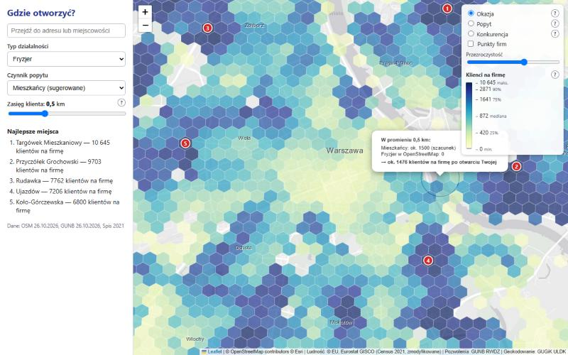
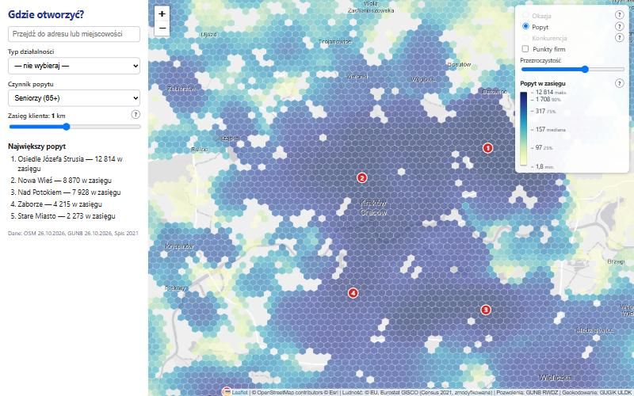
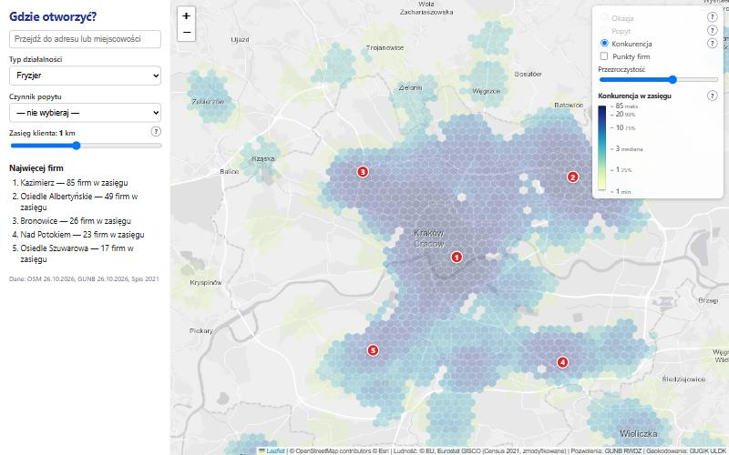
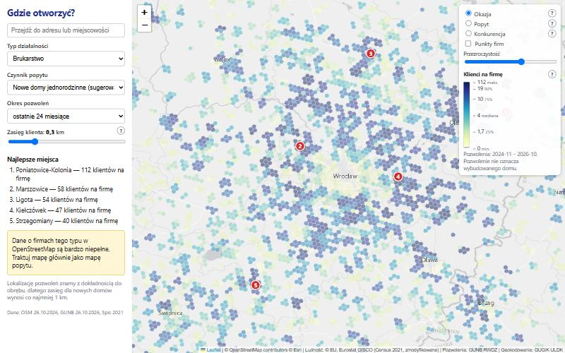
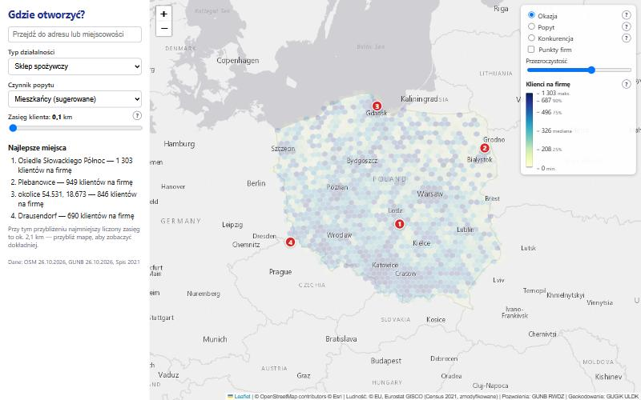
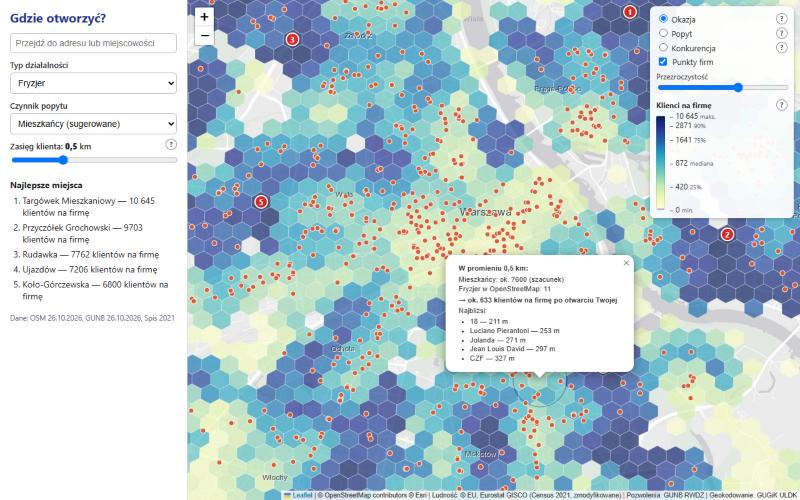
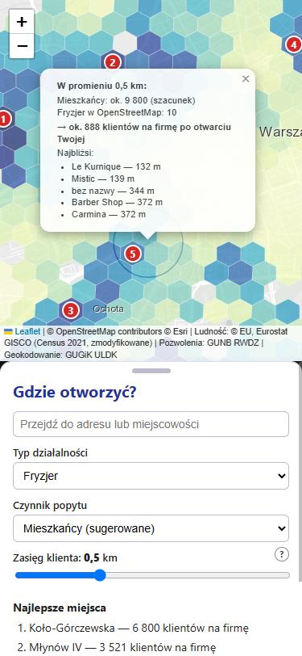

# Gdzie otworzyć? — mapa okazji biznesowych

Aplikacja webowa, która na mapie Polski pokazuje, **gdzie jest dużo potencjalnych klientów i mało konkurencji**. Projekt zaliczeniowy z przedmiotu „Analiza danych przestrzennych”.

Wybierasz typ działalności (16 typów) i/lub czynnik popytu (ludność ze spisu 2021 albo nowe domy z pozwoleń na budowę), ustawiasz **zasięg klienta** (0,1–20 km) i oglądasz mapę. Obszar analizy to **widoczny fragment mapy** — wynik odświeża się sam po przesunięciu lub przybliżeniu. Heksagony są tym drobniejsze, im bardziej przybliżysz mapę. Kolor to płynny gradient wg pozycji miejsca w rankingu widocznego obszaru, a kliknięcie mapy pokazuje dymek z dokładnymi liczbami dla klikniętego punktu.



## Jak używać

- **Tryby jednego wyboru:** sam typ działalności → mapa **konkurencji** („gdzie są fryzjerzy”); sam czynnik popytu → mapa **popytu** („gdzie mieszka dużo seniorów”); oba → warstwy **Okazja / Popyt / Konkurencja**. Pytajniki „?” obok warstw, zasięgu i legendy wyjaśniają, co pokazują.
- **Zasięg klienta:** suwak logarytmiczny 0,1–20 km (salon: ok. 1,5 km, market budowlany: 10–20 km). Małe wartości dają ostrą mapę pojedynczych ulic.
- **Poruszanie się:** przeciągnij i przybliżaj mapę albo wpisz adres w polu na górze panelu (mapa przeskoczy w to miejsce). Link w pasku adresu zapisuje cały widok.
- **Klik w mapę:** dymek z liczbą mieszkańców i firm w okręgu zasięgu, wynikiem „klienci na firmę po otwarciu Twojej” i 5 najbliższymi konkurentami; na mapie rysuje się okrąg zasięgu.
- **Najlepsze miejsca:** 5 ponumerowanych miejsc w widocznym obszarze (klik w znacznik lub listę przybliża mapę).

## Przykłady użycia

| Sam popyt: seniorzy, Kraków, 1 km | Sama konkurencja: fryzjerzy, Kraków, 1 km |
|---|---|
|  |  |

| Brukarz pod Wrocławiem (min. zasięg 1 km dla pozwoleń) | Cała Polska, zasięg 0,1 km |
|---|---|
|  |  |

| Dymek punktu z punktami firm | Telefon (375×812) |
|---|---|
|  |  |

## Jak to działa (metoda)

Dla każdego heksagonu *i* siatki H3 liczymy dwie sumy w **okręgu o promieniu równym zasięgowi klienta** *r* (klasyczny **2SFCA z progiem odległości**, w wersji uproszczonej):

```
D_i = Σ d_j     po komórkach j o środku w odległości ≤ r od i   (popyt, np. liczba mieszkańców)
S_i = Σ s_j     po komórkach j o środku w odległości ≤ r od i   (konkurencja: liczba firm danego typu)

wynik_i = D_i / (S_i + 1)           „klienci na firmę po otwarciu Twojej”
```

„+1” to Ty jako nowy konkurent (i brak dzielenia przez zero). Liczby są całkowite i sprawdzalne — po kliknięciu mapy dymek pokazuje dokładne zliczenia w okręgu.

Najważniejsze decyzje metodyczne (szczegółowo w [docs/sciaga-do-obrony.md](docs/sciaga-do-obrony.md)):

- **Metoda dasymetryczna:** ludność ze spisu (kwadraty 1 km, EPSG:3035) rozkładamy na heksagony H3 **res 9** (~0,1 km²) proporcjonalnie do wagi budynków mieszkalnych z OpenStreetMap (powierzchnia × kondygnacje × współczynnik typu). Komórki bez budynków rozkładamy równomiernie.
- **Poziomy szczegółowości (LOD):** siatka H3 res 9 → 5, rysowana w rozdzielczości zależnej od zoomu (zoom ≥ 12 → res 9, 10–11 → 8, 9 → 7, 7–8 → 6, ≤ 6 → 5). Liczymy na najdrobniejszej rozdzielczości, na jaką pozwala koszt, i agregujemy średnią ważoną liczbą mieszkańców; przy zmianie poziomu siatki płynnie się zamieniają.
- **Gradient wg percentyla** (YlGnBu): kolor = pozycja w rankingu widocznego obszaru; legenda podaje wartości dla min / 25% / mediany / 75% / 90% / max.
- **Cache i przyciąganie bbox** do siatki: małe przesunięcie mapy nie liczy wyniku od nowa i nie zmienia kolorów.
- **Odległości w EPSG:2180** (układ metryczny dla Polski), nie w stopniach; bufor *r* wokół widoku usuwa efekt krawędzi.
- **Top-5** z odstępem ≥ max(2*r*, 1/6 przekątnej widoku) (non-maximum suppression) i z odrzuceniem terenów bez ludności.
- **Geokodowanie obrębów ewidencyjnych** (ULDK GUGiK) dla pozwoleń na budowę — dokładność do obrębu, stąd minimalny zasięg 1 km dla nowych domów.

## Źródła danych i licencje

| Dane | Źródło | Licencja / atrybucja |
|---|---|---|
| Ludność (siatka 1 km, spis 2021) | Eurostat GISCO, Census GRID 2021 (V3) | © EU, Eurostat GISCO — dane zmodyfikowane (agregacja do H3) |
| Firmy i nazwy miejsc | OpenStreetMap (ekstrakt Geofabrik `poland-latest.osm.pbf`) | ODbL, © OpenStreetMap contributors |
| Nowe budowy | GUNB — Rejestr Wniosków, Decyzji i Zgłoszeń (RWDZ), pliki CSV | dane publiczne GUNB |
| Granice obrębów | GUGiK ULDK | dane publiczne GUGiK |
| Podkład mapy | Esri World Light Gray (kafelki) | © Esri i współtwórcy |
| Wyszukiwarka adresów | Nominatim (OpenStreetMap) | ODbL; zapytania z limitem 1/s i pamięcią podręczną |

Podkład: pierwotnie planowano CARTO Positron, ale darmowe kafelki CARTO wymagają teraz klucza API, dlatego użyto jasnoszarego podkładu Esri (osobna warstwa podkładu i etykiet).

## Architektura

```
            (raz + odświeżanie)                                     (na żądanie)
 ┌────────────── ETL (Python) ───────────────┐      ┌──────── Backend FastAPI ────────┐     ┌──── Frontend ────┐
 │ Eurostat Census GRID 2021 → hex_pop_r9     │      │ /api/catalog                    │     │ index.html       │
 │ Geofabrik poland.osm.pbf  → poi, places,   │ ───▶ │ /api/view (okrąg zasięgu,       │ ──▶ │ Leaflet + h3-js  │
 │   building_weights (dasymetria)            │DuckDB│   LOD, percentyle, top-5)       │ JSON│ (bez buildowania)│
 │ GUNB RWDZ CSV + ULDK      → permits        │ plik │ /api/point (dymek punktu)       │     │                  │
 │ agregacja do H3 res 9 → 8 → 7 → 6 → 5      │      │ /api/poi /api/geocode /api/meta │     │                  │
 └────────────────────────────────────────────┘      └─────────────────────────────────┘     └──────────────────┘
```

Dlaczego ETL zamiast zapytań na żywo: publiczne Overpass API blokuje automatyczne zapytania, a ULDK odpowiada ~0,35 s na działkę. Dane pobieramy hurtowo z otwartych plików i przetwarzamy raz do pliku DuckDB (`data/app.duckdb`) — backend tylko liczy na gotowych tabelach.

Struktura repozytorium:

```
backend/app/        FastAPI: main.py, config.py, db.py, catalog.py, api/routes.py,
                    analysis/{kernel,scoring,resolution,service}.py, services/geocode.py
etl/                download.py, osm_poi.py, buildings.py, population.py, permits.py,
                    geocode_obreby.py, aggregate.py, meta.py, run_all.py, sanity.py
frontend/           index.html, css/style.css, js/{app,api,map,ui,colors}.js
tests/              pytest (małe fixture'y, baza testowa budowana w locie)
docs/               specyfikacja, plan, źródła danych, raport ETL, ściąga do obrony
```

## Instalacja i uruchomienie (Windows 11)

Wymagania: Windows 11, ≥ 16 GB RAM, ≥ 20 GB wolnego dysku, dostęp do internetu (jednorazowo ~3 GB danych).

```powershell
winget install --id=astral-sh.uv -e      # menedżer Pythona (po instalacji otwórz nową powłokę)
uv sync                                   # Python 3.13 + biblioteki (środowisko .venv)
uv run python -m etl.run_all              # ETL: pobieranie i przetwarzanie danych (kilka godzin, jednorazowo; budynki OSM ok. 16 min)
uv run python -m etl.sanity               # kontrola jakości danych (powinno wypisać OK)
start.bat                                 # serwer: http://localhost:8000
```

Uwagi:
- Używamy Pythona 3.13 zarządzanego przez `uv` (`.python-version`); systemowego Pythona nie trzeba instalować.
- ETL można przerwać i wznowić — pobieranie i geokodowanie są wznawialne. `--only buildings,population,aggregate` uruchamia wybrane kroki, `--force` wymusza ponowne wykonanie.
- Serwer i ETL nie mogą działać jednocześnie (blokada pliku DuckDB).
- Serwer ULDK (GUGiK) może po godzinie intensywnych zapytań zablokować połączenie (przekierowanie na stronę-pułapkę). Geokodowanie przerywa się wtedy z komunikatem; odczekaj i dokończ: `uv run python -m etl.run_all --only geocode,permits_hex,aggregate --force` (szczegóły i aktualny stan: [docs/raport-etl.md](docs/raport-etl.md)).
- Testy: `uv run pytest -v`.

## Dostęp z innego urządzenia przez Tailscale

Aplikacja działa na komputerze domowym; z laptopa (np. na uczelni) otwierasz ją przez prywatną sieć Tailscale.

1. Zainstaluj Tailscale na komputerze z aplikacją i na laptopie (https://tailscale.com/download), zaloguj oba tym samym kontem.
2. Na komputerze z aplikacją zezwól na ruch przychodzący na port 8000 w Zaporze Windows (PowerShell jako administrator):
   `New-NetFirewallRule -DisplayName "Gdzie otworzyc 8000" -Direction Inbound -Protocol TCP -LocalPort 8000 -Action Allow -Profile Private`
   (sieć Tailscale ma zwykle profil „prywatny”; w razie problemów dodaj regułę dla interfejsu Tailscale).
3. Uruchom `start.bat` i na laptopie wejdź na `http://<nazwa-komputera>:8000` (nazwę widać w aplikacji Tailscale, działa MagicDNS).
4. Opcjonalnie publiczny link dla prowadzącego: `tailscale funnel 8000` (wyłącz po pokazie).

## Ograniczenia danych

- **OpenStreetMap jest niekompletny**, zwłaszcza dla małych usług (fryzjerzy, brukarze). Wynik „mało konkurencji” może oznaczać „mało wpisów w OSM”; dla typów z oceną „poor” aplikacja ostrzega, że to głównie mapa popytu.
- **Spis ludności jest z 2021 r.**; uzupełniają go pozwolenia na budowę.
- **Pozwolenie na budowę ≠ wybudowany dom** (budowa trwa 1–3 lata, część nie rusza), a lokalizacja jest z dokładnością do obrębu ewidencyjnego (miasto: osiedle, wieś: cała wieś) — dlatego zasięg dla nowych domów wynosi co najmniej 1 km.
- **Ludność w heksagonach to szacunek modelowy** (metoda dasymetryczna): spis podaje tylko kwadraty 1 km, a rozkład wewnątrz kwadratu wynika z wag budynków OSM (nie znamy liczby mieszkań w budynku).
- **Kolory są względne dla widoku** (percentyl), a liczby „klientów na firmę” są zawyżone, bo OSM ma ok. 1/3–1/4 firm — mapę czytamy porównawczo.
- Liczba „nowych budynków wielorodzinnych” to liczba inwestycji, nie mieszkań (rejestr nie podaje liczby lokali).
- Wynik jest rankingiem pomocniczym, nie prognozą zysku.

## Plany rozwoju (poza zakresem tej wersji)

- **M6** warstwa „Trend” dla budowlanki (ostatnie 12 mies. vs poprzednie 12),
- **M7** hot-spoty Getis-Ord Gi\*,
- **M8** model ML „luki rynkowej” (gradient boosting, walidacja przestrzenna po województwach),
- **M9** integracja CEIDG jako drugie źródło konkurencji (kody PKD są już w katalogu),
- **M10** dokładne geokodowanie działek dla ostatnich 24 miesięcy.

Dokumentacja: [specyfikacja v1](docs/superpowers/specs/2026-10-26-gdzie-otworzyc-design.md), [specyfikacja v2](docs/superpowers/specs/2026-10-27-widok-dynamiczny-design.md), [plan v1](docs/superpowers/plans/2026-10-26-gdzie-otworzyc.md), [plan v2](docs/superpowers/plans/2026-10-27-widok-dynamiczny.md), [źródła danych](docs/zrodla-danych.md), [raport ETL](docs/raport-etl.md), [ściąga do obrony](docs/sciaga-do-obrony.md).
