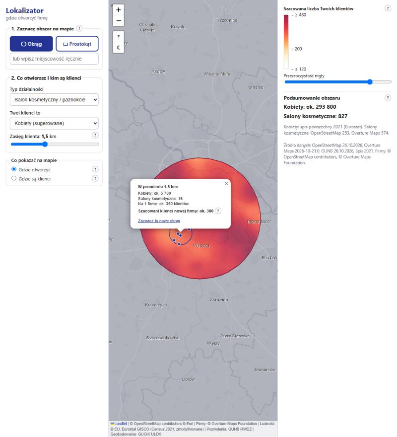
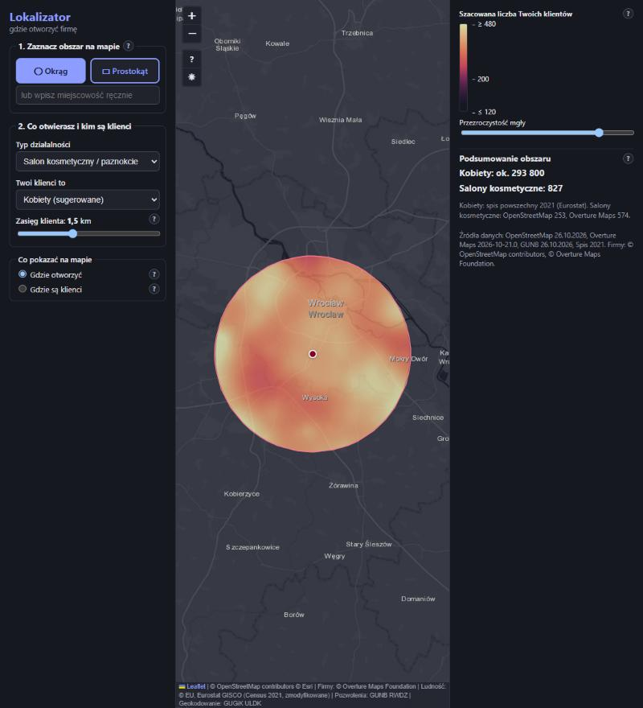

# Lokalizator — gdzie otworzyć firmę

Aplikacja webowa z mapą Polski, która odpowiada przedsiębiorcy na pytanie: **gdzie otworzyć firmę (albo gdzie się reklamować), żeby mieć najwięcej klientów i najmniej konkurencji?** Projekt zaliczeniowy z przedmiotu „Analiza danych przestrzennych”.

Zaznaczasz obszar (okrąg albo prostokąt, od kilku ulic po całą Polskę), wybierasz branżę i/lub klientów i klikasz **„Analizuj obszar”**. W obszarze pojawia się **mgła** — płynna mapa szacowanej liczby klientów nowej firmy (model Huffa) — a po prawej dwie liczby: ilu klientów i ile firm jest w obszarze, ze źródłami. Kliknięcie w mapę pokazuje liczby dla jednego miejsca.

| Jasny wygląd: salony kosmetyczne we Wrocławiu, dymek po kliknięciu | Tryb nocny (paleta magma: jaśniej = więcej) |
|---|---|
|  |  |

## Jak używać

1. **Wybierz narzędzie** w lewym panelu: **„◯ Okrąg”** albo **„▭ Prostokąt”**. Żadne nie jest wybrane na start; drugie kliknięcie w wybrane narzędzie je odznacza (lewy przycisk znów przesuwa mapę). Przy pierwszej wizycie animacja pokazuje, jak zacząć (przycisk „?” przy mapie odtwarza ją ponownie).
2. **Zaznacz obszar:**
   - **okrąg** — kliknij mapę: okrąg ma ok. **20% krótszego boku ekranu** (przy widoku całej Polski ok. 200 km, w mieście kilka km), a mapa płynnie się na nim centruje. Kropka na krawędzi zmienia promień, kropka w środku przesuwa okrąg, promień można też wpisać w km;
   - **prostokąt** — przeciągnij po mapie; rogi zmieniają rozmiar, kropka w środku przesuwa (bok 0,6–700 km);
   - **lub wpisz miejscowość** — mapa przeleci do niej i zaznaczy okrąg o średnicy 5 km. Kliknięcie drugiego narzędzia zamienia zaznaczenie w tym samym miejscu (okrąg → kwadrat, prostokąt → okrąg).
3. **Wybierz branżę** („Typ działalności”, 10 typów) i/lub **klientów** (mieszkańcy, kobiety, mężczyźni, dzieci, seniorzy — spis 2021), a pod nimi **zasięg klienta** (0,3–20 km). Kto pracuje przy budowie (brukarz, instalator, okna, kuchnie), wybiera **„Pracuję przy budowie / wykończeniu”** — wtedy klientami są **nowe domy i bloki** z pozwoleń na budowę (zasięg od 1 km, okres pozwoleń), a konkurencji nie liczymy. Dopóki nic nie wybierzesz, karta przy obszarze nie ma przycisku „Analizuj”. **Nic nie liczy się samo.**
4. **„✓ Analizuj obszar”** — każdy obszar, aż do całej Polski, liczy się z Twoimi ustawieniami (zwykle 2–7 s). Poza obszarem mapa jest przygaszona. Kolory są dopasowane do tego, co widać na ekranie: po przybliżeniu do miasta widać różnice między ulicami (bez nowych zapytań). Zmiana ustawień po analizie przelicza ten sam obszar.
5. **„Co pokazać na mapie”:** „Gdzie otworzyć” (szacowana liczba Twoich klientów), „Gdzie są klienci” (ilu klientów mieszka w zasięgu od danego miejsca), „Gdzie są {firmy}” (sama branża); przy budowie — „Gdzie się buduje” i „Gdzie buduje się więcej niż rok temu”.
6. **Po prawej:** legenda, liczba klientów i firm w obszarze, a pod nimi źródła (np. „Salony kosmetyczne: OpenStreetMap 253, Overture Maps 574”). **Kliknięcie w zbadany obszar:** okrąg zasięgu klienta i nad nim dymek — liczby w tym okręgu (dokładnie te, które daje kolor mapy „Gdzie są klienci” w tym miejscu), liczba klientów na firmę (gdy firm jest co najmniej 2) i szacowani klienci nowej firmy (pytajnik wyjaśnia, skąd ta liczba). **Kropka na okręgu zasięgu** zmienia zasięg (suwak przesuwa się razem z nią, obszar liczy się od nowa); ✕ zamyka dymek.
7. **Tryb nocny** włącza się jak w systemie; przycisk ☾/☀ przy mapie przełącza go ręcznie. **Odświeżenie strony** zaczyna od zera (ustawienia fabryczne). Na telefonie panele to zakładki „Ustawienia” / „Wnioski” na dole ekranu.

## Jak to działa (metoda)

Dla zaznaczonego obszaru serwer buduje **siatkę punktów ułożoną jak piksele mgły na ekranie** (kolumny równo w długości geograficznej, wiersze równo w rzucie Merkatora, jak kafelki mapy), a odległości liczy w metrach (lokalny układ metryczny). Każde źródło popytu *i* (komórka H3 z ludnością albo pozwoleniami, `d_i` osób) i każdy konkurent *k* (firma z OpenStreetMap albo Overture Maps) wpływa na punkt siatki *g*:

```
Gdzie są klienci:  P(g) = Σ_i d_i · [d_ig ≤ zasięg]        (suma w ruchomym oknie: ilu klientów mieszka w zasięgu)
Gdzie są firmy:    K(g) = Σ_k [d_kg ≤ zasięg]              (ile firm jest w zasięgu)
Gdzie otworzyć:    E(g) = Σ_i d_i · f(d_ig) / ( f(d_ig) + C_i + A0 )     (model Huffa)
                   f(d) = exp(−d / zasięg) (obcięty dla d > 4·zasięg),  C_i = Σ_k f(d_ik),  A0 = exp(−1)
```

**P i K to sumy w ruchomym oknie** — okrąg o promieniu zasięgu przesuwany po mapie. Kolor w punkcie to dokładnie ta liczba, którą pokazuje dymek po kliknięciu tam („W promieniu 1 km: …”). Wcześniej P i K miały rozpad z odległością i liczyły też ludzi do 4 × zasięg — kolor mówił „2 nowe bloki”, a dymek „w promieniu 1 km: 0”. Przy budowach (pozwolenie znamy jako punkt obrębu) mapa wygląda przez to jak nakładające się koła wokół miejsc z pozwoleniami — tak wyglądają te dane naprawdę.

**Model Huffa (1963):** każdy mieszkaniec wybiera między firmami, a bliższa przyciąga go mocniej; `E(g)` to szacowana liczba klientów **nowej** firmy w punkcie *g*. **Opcja zewnętrzna `A0`** reprezentuje „inne możliwości” (firmy spoza obu baz, zakupy gdzie indziej) i częściowo kompensuje ich niekompletność. Przeglądarka **interpoluje** wartości siatki (×4, smoothstep) i dopiero potem koloruje — stąd gładka powierzchnia. Po kliknięciu `/api/point` liczy dokładne liczby w okręgu zasięgu i ten sam wzór Huffa dla jednego punktu.

**Gęstość siatki:** krok = promień/90 (ok. 180 punktów w poprzek), ale **najwyżej pół zasięgu** — okno o promieniu zasięgu musi „nachodzić” na sąsiednie punkty, inaczej między nimi zostają dziury. Limit to 250 tys. punktów w obszarze. Pomiar na prawdziwej bazie: miasto ok. 1 s, okrąg 150 km z zasięgiem 1,5 km ok. 8 s, budowy w promieniu 240 km ok. 2 s. Gdy limit nie pozwala (cała Polska i zasięg 0,3 km), serwer podnosi zasięg do kroku siatki, a suwak pokazuje wartość, z którą naprawdę liczyliśmy. Sprawdzone: na losowych punktach (8 km, 150 km i 300 km) wartość mapy = liczba z dymku.

### „Mało danych o firmach” — szare kreskowanie

Model Huffa wierzy danym. W miasteczku, w którym w OSM i Overture nie ma **ani jednego salonu**, „nowa firma zgarnia wszystkie klientki” — a to najczęściej luka w danych, nie okazja. Krok ETL **`gaps`** (`etl/gaps.py`) wykrywa takie miejsca osobno dla każdego typu firmy:

```
oczekiwane = (mieszkańcy w promieniu 2 km) × (firm tego typu w Polsce / mieszkańców Polski)
w danych   = firm tego typu w promieniu 2 km
luka       = oczekiwane ≥ 3  ORAZ  w danych ≤ 0,25 · oczekiwane
```

Drugi przebieg Huffa z wagami `d_i · luka_i` daje `E_luka`; miejsca, w których ponad połowa klientów mieszka w lukach, mają na warstwie „Gdzie otworzyć” **szare ukośne kreskowanie**, a podsumowanie i dymek mówią jednym zdaniem, że w danych prawdopodobnie brakuje firm. Progi ustalono pomiarem (w lukach mieszka 1,7% ludności dla salonów, 0,9% dla fryzjerów; Brzeg, Oława i Wrocław bez luk) — stałe `GAP_*` w `backend/app/catalog.py`. Miejscowości z < 3 oczekiwanymi firmami nie są oceniane.

### Najważniejsze decyzje (szczegółowo w [ściądze do obrony](docs/sciaga-do-obrony.md))

- **Metoda dasymetryczna:** ludność ze spisu (kwadraty 1 km, EPSG:3035) rozkładamy na heksagony H3 **res 9** (~0,1 km²) proporcjonalnie do wagi budynków mieszkalnych z OSM (powierzchnia × kondygnacje × współczynnik typu); przy dużym zasięgu źródła są grubsze (res 8/7).
- **Powierzchnia ciągła zamiast heksagonów/choropletu:** wartości zmieniają się płynnie, więc pokazujemy izopletę-mgłę.
- **Skala logarytmiczna z przezroczystością:** górna granica = 99. percentyl wartości widocznych na ekranie, dolna = 5. percentyl, ale skala obejmuje od 4× do 100× — różnica 20% to ledwie inny odcień, 60% — wyraźnie inny. Paleta jednobarwna: YlOrRd (jasny wygląd), magma (tryb nocny — na ciemnym podkładzie „więcej” musi być jaśniej, inaczej ciemnoczerwony zniknąłby w tle).
- **Firmy z dwóch źródeł (OSM + Overture Maps):** OSM ma dla usług kilka razy mniej firm niż Overture (okrąg we Wrocławiu ze zrzutu powyżej: 253 salony z OSM i 574 dodatkowe z Overture). **Deduplikacja przestrzenna:** obiekt Overture odpada, gdy w ≤ 50 m jest punkt OSM tego samego typu albo w ≤ 150 m punkt o podobnej nazwie (`difflib`, próg 0,6).
- **Uczciwy katalog branż:** firm pracujących u klienta (brukarz, ogrodnik, instalator) w OSM i Overture jest o rząd wielkości mniej niż w rzeczywistości ([kompletność danych](docs/kompletnosc-danych.md)), więc nie liczymy dla nich konkurencji. Mają jedną pozycję „Pracuję przy budowie / wykończeniu”, przy której klientami są nowe domy i bloki z pozwoleń. Przy pozostałych branżach klientami są tylko ludzie — „barber + nowe bloki” nie miało sensu. „Stylizacja paznokci” jest częścią salonu kosmetycznego.
- **Mapa trendu:** dla pozwoleń liczymy różnicę „ostatnie 12 miesięcy minus poprzednie 12”; paleta rozbieżna (niebieski = ubywa, czerwony = przybywa), bo zmiana ma znak.
- **Zasięg ≥ 0,3 km:** ludność mamy w komórkach H3 res 9 (~300 m między środkami), mniejszy zasięg nie dodaje informacji. Dla pozwoleń ≥ 1 km (lokalizacja z dokładnością do obrębu).
- **Odległości w metrach** (lokalny układ metryczny, dla danych EPSG:2180), nie w stopniach; bufor `4·zasięg` wokół obszaru usuwa efekt krawędzi.
- **Prostota interfejsu:** na ekranie tylko liczby, które odpowiadają na pytanie, i źródła; wyjaśnienia są pod pytajnikami. Werdykt „mniej / więcej konkurencji niż w podobnych miejscach” i ranking najlepszych miejsc backend nadal liczy, ale interfejs ich nie pokazuje (tester uznał je za szum; ranking na dużym obszarze mieszałby miasta ze wsiami).

## Zasady wizualizacji

- **Shneiderman (1996):** *overview first, zoom and filter, then details-on-demand* → obszar (zawężenie) → mgła (przegląd) → klik (szczegóły).
- **Huff (1963)**, używany też w ArcGIS Business Analyst → liczba klientów nowej firmy zamiast surowego popytu.
- **Izopleta zamiast choropletu i hexbinów** dla wartości zmieniających się płynnie (mniej artefaktów granic).
- **Borland & Taylor (2007), „Rainbow Color Map (Still) Considered Harmful”**, **ColorBrewer** (YlOrRd) i **magma** (matplotlib, równomierna percepcyjnie) → jednobarwne skale sekwencyjne, nie tęcza.
- **xkcd 1138 („Heatmap”):** mapa samej ludności niczego nie wyjaśnia — główna mapa odpowiada na pytanie „ilu klientów zdobędę”.
- Odrzucone: mapa bivariate (trudna w odczycie), Leaflet.heat (obraz zależy od przybliżenia i nie odpowiada liczbom).

## Źródła danych i licencje

| Dane | Źródło | Licencja / atrybucja |
|---|---|---|
| Ludność (siatka 1 km, spis 2021) | Eurostat GISCO, Census GRID 2021 (V3) | © EU, Eurostat GISCO — dane zmodyfikowane (agregacja do H3) |
| Firmy, ulice i nazwy miejsc | OpenStreetMap (ekstrakt Geofabrik `poland-latest.osm.pbf`) | ODbL, © OpenStreetMap contributors |
| Firmy (drugie źródło) | Overture Maps Foundation, Places (wydanie 2026-10-21.0) | CDLA Permissive 2.0, © Overture Maps Foundation |
| Nowe budowy | GUNB — Rejestr Wniosków, Decyzji i Zgłoszeń (RWDZ), pliki CSV | dane publiczne GUNB |
| Granice obrębów | GUGiK ULDK | dane publiczne GUGiK |
| Podkład mapy | Esri World Light Gray / Dark Gray (kafelki) | © Esri i współtwórcy |
| Wyszukiwarka miejscowości | Nominatim (OpenStreetMap) | ODbL; limit 1 zapytanie/s, pamięć podręczna, bez powtórzonych nazw |

Formaty i pułapki źródeł: [docs/zrodla-danych.md](docs/zrodla-danych.md).

## Architektura

```
            (raz + odświeżanie)                                     (na żądanie)
 ┌────────────── ETL (Python) ───────────────┐      ┌──────── Backend FastAPI ────────┐     ┌──── Frontend ────┐
 │ Eurostat Census GRID 2021 → hex_pop_r9     │      │ /api/catalog                    │     │ index.html       │
 │ Geofabrik poland.osm.pbf  → poi, places,   │ ───▶ │ /api/surface (mgła: siatka,     │ ──▶ │ Leaflet          │
 │   streets, building_weights (dasymetria)   │DuckDB│   Huff, podsumowanie, trend)    │ JSON│ (bez buildowania)│
 │ Overture Places (S3)      → poi (dedup.)   │ plik │ /api/point (dymek punktu)       │     │                  │
 │ GUNB RWDZ CSV + ULDK      → permits        │      │ /api/poi /api/geocode /api/meta │     │                  │
 │ agregacja do H3 res 9 → 8 → 7 → 6 → 5      │      │ /api/national (gotowa mapa PL,  │     │                  │
 │ gaps: luki w danych o firmach              │      │   obecnie nieużywana w UI)      │     │                  │
 │ national: Huff dla całej Polski (res 8)    │      │                                 │     │                  │
 └────────────────────────────────────────────┘      └─────────────────────────────────┘     └──────────────────┘
```

Dlaczego ETL zamiast zapytań na żywo do źródeł: publiczne Overpass API blokuje automatyczne zapytania, a ULDK odpowiada ~0,35 s na działkę. Dane pobieramy hurtowo z otwartych plików i przetwarzamy raz do pliku DuckDB (`data/app.duckdb`) — backend tylko liczy na gotowych tabelach. Wyniki ETL i czasy kroków: [docs/raport-etl.md](docs/raport-etl.md).

```
backend/app/        FastAPI: main.py, config.py, db.py, catalog.py, api/routes.py,
                    analysis/{kernel,surface,service,layers,national}.py, services/geocode.py
etl/                download.py, osm_poi.py, overture.py, streets.py, buildings.py, population.py, permits.py,
                    geocode_obreby.py, aggregate.py, gaps.py, national.py, meta.py, run_all.py, sanity.py
frontend/           index.html, css/style.css, js/{app,api,map,ui,colors,intro}.js
tests/              pytest (baza testowa budowana w locie); tests/e2e — przeglądarka klika jak użytkownik
docs/               źródła danych, raport ETL, kompletność danych, audyt przydatności, ściąga do obrony, zrzuty
```

## Instalacja i uruchomienie (Windows 11)

Wymagania: Windows 11, ≥ 16 GB RAM, ≥ 20 GB wolnego dysku, dostęp do internetu (jednorazowo ~3 GB danych).

```powershell
winget install --id=astral-sh.uv -e      # menedżer Pythona (po instalacji otwórz nową powłokę)
uv sync                                   # Python 3.13 + biblioteki (środowisko .venv)
uv run python -m etl.run_all              # ETL: pobieranie i przetwarzanie danych (kilka godzin, jednorazowo)
uv run python -m etl.sanity               # kontrola jakości danych (powinno wypisać OK)
start.bat                                 # serwer: http://localhost:8000
```

- Python 3.13 zarządzany przez `uv` (`.python-version`); systemowego Pythona nie trzeba instalować.
- ETL można przerwać i wznowić. Po zmianie danych o firmach lub ludności: `uv run python -m etl.run_all --only aggregate,gaps,national --force`.
- Serwer i ETL nie mogą działać jednocześnie (blokada pliku DuckDB).
- ULDK (GUGiK) po godzinie intensywnych zapytań potrafi zablokować połączenie — odczekaj i dokończ: `uv run python -m etl.run_all --only geocode,permits_hex,aggregate --force`.
- Testy: `uv run pytest -v`. Testy „jak użytkownik” (`tests/e2e`) wymagają jednorazowo `uv run playwright install chromium` — bez tego pomijają się same.

## Dostęp z innego urządzenia przez Tailscale

1. Zainstaluj Tailscale na komputerze z aplikacją i na laptopie (https://tailscale.com/download), zaloguj oba tym samym kontem.
2. Na komputerze z aplikacją zezwól na ruch na port 8000 (PowerShell jako administrator):
   `New-NetFirewallRule -DisplayName "Lokalizator 8000" -Direction Inbound -Protocol TCP -LocalPort 8000 -Action Allow -Profile Private`
3. Uruchom `start.bat` i na laptopie wejdź na `http://<nazwa-komputera>:8000` (nazwa w aplikacji Tailscale).
4. Opcjonalnie publiczny link dla prowadzącego: `tailscale funnel 8000` (wyłącz po pokazie).

## Ograniczenia

- **OpenStreetMap i Overture Maps są niekompletne**, zwłaszcza dla małych usług — liczba firm bywa zaniżona, a „mało konkurencji” może znaczyć „mało wpisów w bazach”. Kreskowanie ostrzega o wyraźnych lukach, ale ich nie uzupełnia (to zrobi CEIDG). Deduplikacja jest heurystyką.
- **Ten sam zasięg klienta w mieście i na wsi:** model nie widzi, że mieszkańcy wsi dojeżdżają do firm w mieście dalej niż 4 × zasięg, więc na słabo zaludnionym terenie liczba klientów jest zawyżona. Poprawka (zasięg zależny od gęstości) wymaga kalibracji — [audyt](docs/audyt-przydatnosci.md), sekcja B4.
- **Popyt to miejsce zamieszkania ze spisu 2021** — bez miejsc pracy, dojazdów, turystów i osób, które przyjechały po spisie; nie znamy zamożności (najbardziej dotyczy kawiarni i restauracji).
- **Ludność w heksagonach to szacunek** (metoda dasymetryczna): spis podaje tylko kwadraty 1 km.
- **Pozwolenie na budowę ≠ wybudowany dom**, lokalizacja z dokładnością do obrębu; blok liczy się jak jeden budynek.
- **Kolory są względne dla tego, co widać na ekranie** — dokładne liczby są w legendzie i w dymku.
- **Każda firma jest tak samo atrakcyjna** w modelu Huffa (dyskont = mały sklep).
- Wynik to pomoc w porównywaniu miejsc, nie prognoza sprzedaży.

## Plany rozwoju

- **CEIDG** jako trzecie źródło firm (kody PKD są w katalogu) — najważniejsze dla branż, których nie ma w OSM/Overture.
- **Zasięg klienta zależny od gęstości zaludnienia** (wieś > miasto).
- **Zamożność i ludność dzienna** (GUS BDL: dochody gmin, przepływy do pracy).
- Hot-spoty Getis-Ord Gi\*, model ML „luki rynkowej” z walidacją przestrzenną.

Dokumentacja: [ściąga do obrony](docs/sciaga-do-obrony.md), [źródła danych](docs/zrodla-danych.md), [raport ETL](docs/raport-etl.md), [kompletność danych](docs/kompletnosc-danych.md), [audyt przydatności (v3.5)](docs/audyt-przydatnosci.md).
