# Gdzie otworzyć? — mapa okazji biznesowych

Aplikacja webowa, która na mapie Polski pokazuje, **gdzie jest dużo potencjalnych klientów i mało konkurencji**. Projekt zaliczeniowy z przedmiotu „Analiza danych przestrzennych”.

Wybierasz typ działalności (11 typów) i/lub klientów (ludność ze spisu 2021 albo nowe domy z pozwoleń na budowę) i od razu widzisz **mgłę** — płynną żółto-czerwoną mapę — **na całą Polskę**. Przybliżasz mapę do swojego miasta, a mgła przelicza się **na żywo** z Twoimi ustawieniami (**zasięg klienta** 0,3–20 km); kliknięcie w mapę pokazuje szczegóły. Drugi tryb, **„Wybrane miejsce”**, analizuje okrąg (1–30 km) albo **zaznaczony prostokąt** z podsumowaniem i porównaniem ze średnią krajową. Obszar wybiera się **gestem na mapie** (v3.4): kliknięciem (karta z suwakiem promienia i przyciskiem ✓) albo przyciskiem **„▭ Prostokąt”** (zaznaczasz, łapiesz za rogi, ✓). Po lewej są **same ustawienia**, po prawej **wnioski**: legenda, top-5 miejsc w widoku i (dla widoku na żywo oraz wybranego miejsca) podsumowanie obszaru.

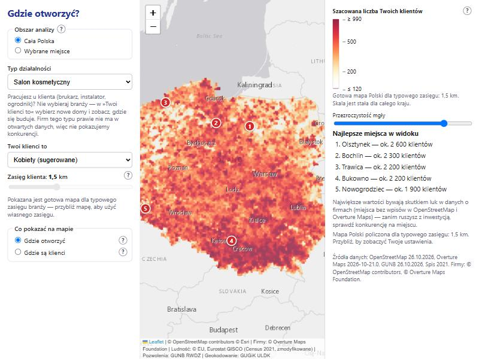

## Jak używać

0. **Obszar analizy** (góra lewego panelu): **Cała Polska** (domyślnie) albo **Wybrane miejsce**. W trybie „Cała Polska” pola „Miejsce”, „Promień obszaru” i przycisk „Pokaż mapę” są ukryte — mgła pojawia się sama po wybraniu branży lub klientów. **Po oddaleniu** (widok szerszy niż ok. 40 km) widać **gotową mapę Polski** policzoną w ETL dla typowego zasięgu branży (suwak zasięgu i okres pozwoleń są wtedy nieaktywne — gotowa mapa jest policzona dla typowego zasięgu branży i 24 miesięcy — a skala kolorów jest stała dla całego kraju); **po przybliżeniu do miasta** mgła liczy się **na żywo** z ustawieniami użytkownika, a kolory dopasowują się do widoku (legenda to mówi). Zapytania idą dopiero po zakończeniu ruchu mapy (opóźnienie 250/400 ms, stare zapytania są anulowane), a nowa mgła przenika w starą (~250 ms). Kliknięcie w mapę pokazuje szczegóły punktu z przyciskiem **„Przeanalizuj to miejsce”** (przełącza na „Wybrane miejsce” z tym punktem).
1. **Lewy panel (ustawienia):** wybierz **branżę** („Typ działalności”) i/lub **klientów** („Twoi klienci to”); przy nowych domach wybierz okres pozwoleń.
2. **Wskaż obszar na mapie (v3.4):** **kliknij mapę** — pojawia się pinezka, przerywany okrąg podglądu i **karta wyboru**: liczby tego punktu (klienci w zasięgu, „Otwierając tu zdobyłbyś…”, ostrzeżenie o luce w danych), suwak **„Obszar analizy: X km”** (1–30 km; okrąg na mapie zmienia się na żywo, bez zapytań do serwera) oraz przyciski **✓ Analizuj obszar** i **✕**. Albo kliknij **„▭ Prostokąt”** (pod przyciskami +/−), przeciągnij ramkę po mapie i — łapiąc za **rogi** — zmień jej rozmiar; napis na karcie podaje wymiary („12,7 × 8,2 km”), a poza limitami (bok 0,6–60 km) ramka jest czerwona i ✓ nieaktywny. Przeciąganie mapy bez tego przycisku nadal ją przesuwa (też palcem na telefonie). Przy pierwszej wizycie krótka **animacja** pokazuje oba gesty (przycisk „?” przy mapie odtwarza ją ponownie). Formularz („Miejsce” z wyszukiwarką i „Promień obszaru”) zostaje jako druga droga: wybór z wyszukiwarki też tworzy kartę z ✓. Ustaw też **zasięg klienta** (suwak logarytmiczny 0,3–20 km; fryzjer ok. 1,5 km, market budowlany 10–20 km). Zasięg nie schodzi poniżej 0,3 km, bo dane o mieszkańcach mają rozdzielczość ok. 300 m.
3. **„Co pokazać na mapie”:** typ + klienci → **„Gdzie otworzyć”** (szacowana liczba Twoich klientów, model Huffa) i **„Gdzie są klienci”**; tylko typ → **„Gdzie są {firmy}”**; tylko klienci → **„Gdzie są klienci”**; klienci z pozwoleń na budowę → dodatkowo **„Gdzie budowy przybywa”** (mapa trendu). Pytajniki wyjaśniają każdą warstwę.
4. ✓ na karcie (albo **„Pokaż mapę”** w lewym panelu) przełącza na „Wybrane miejsce” i analizuje obszar. Poza obszarem (okręgiem albo prostokątem) mapa jest przygaszona, w okręgu widać mgłę. Zmiana ustawień przelicza mapę sama (po 300 ms); **ruch i przybliżanie mapy nie wysyłają żadnych zapytań**.
5. **Prawy panel (wnioski):** legenda (skala obejmuje 2 rzędy wielkości), **podsumowanie obszaru** („Kobiety: ok. 18 800 · Salony kosmetyczne w obszarze: 36 (OSM 18, Overture 18) · 1 firma na ok. 520 kobiet · Średnio w Polsce: 1 na ok. 610 · Konkurencja na poziomie średniej krajowej”) i top-5 z nazwami ulic (klik = przelot na mapie i szczegóły).
6. **Kliknięcie w mapę:** wewnątrz bieżącej analizy (okręgu albo prostokąta) — szczegóły punktu (okrąg zasięgu, konkurenci, dymek: „W promieniu 1 km: ok. 11 100 kobiet · Otwierając tu, zdobyłbyś ok. 560 klientów”, z linkiem „Ustaw tu środek obszaru”); **wszędzie indziej — nowy wybór** (karta z suwakiem i ✓, jak w punkcie 2; w trybie „Cała Polska” zastępuje dawny dymek z przyciskiem „Przeanalizuj to miejsce”). Zamknięcie dymku czyści szczegóły, ✕ czyści wybór.
7. Adres strony (hash) zapisuje cały widok (`mode=pl` z `z`, `clat`, `clng`; `mode=place` z miejscem i promieniem albo `bbox=zachód,południe,wschód,północ` dla prostokąta) — link można wysłać i odtworzy tę samą mapę; stary link z usuniętym typem (np. brukarstwo) działa i zostawia czynnik popytu. Na telefonie panele to zakładki „Ustawienia” / „Wnioski” arkusza na dole (po „Pokaż mapę” otwierają się „Wnioski”).

## Przykłady użycia

| Przybliżanie: gotowa mapa Dolnego Śląska (stała skala) | Wrocław: gotowa mapa |
|---|---|
| 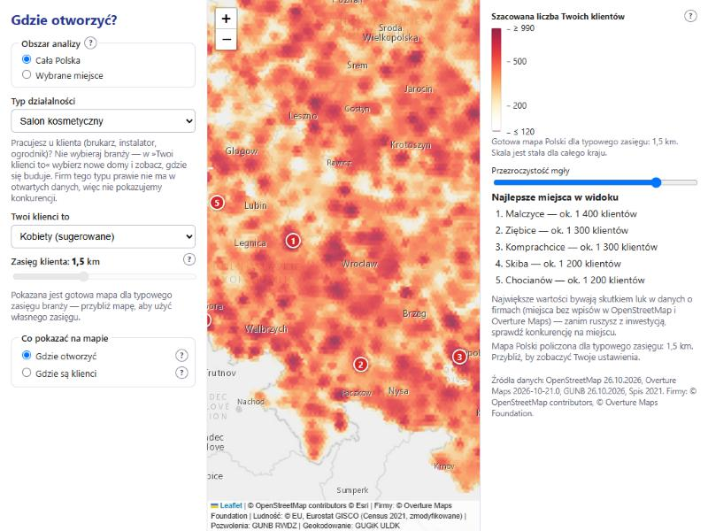 | 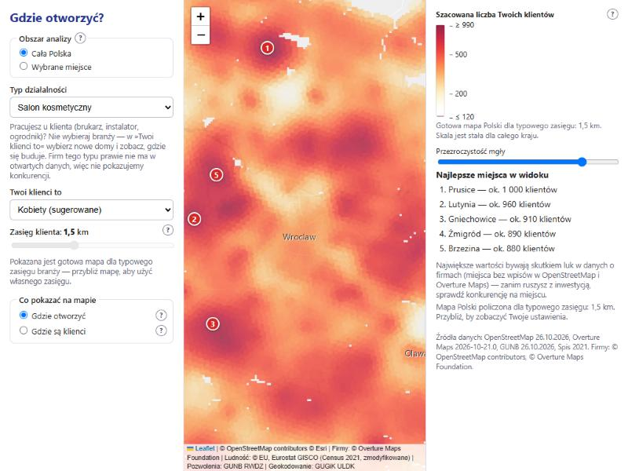 |

| Dalsze przybliżenie: mapa na żywo + podsumowanie widocznego obszaru | Klik w mapę: szczegóły i „Przeanalizuj to miejsce” |
|---|---|
| 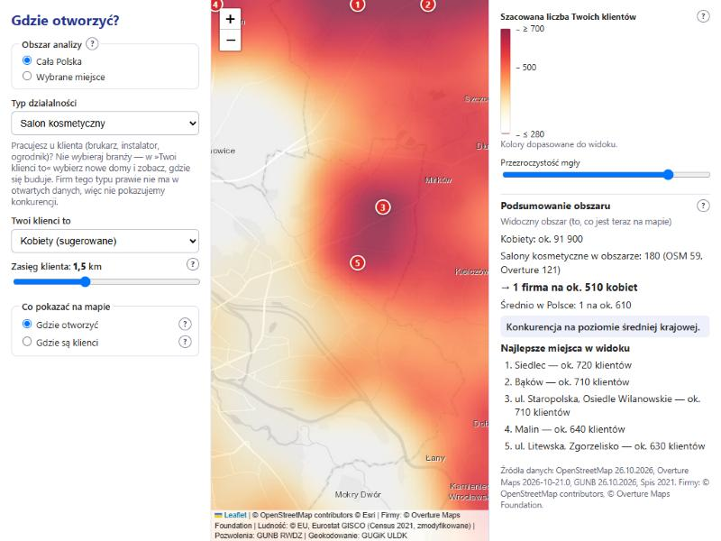 | 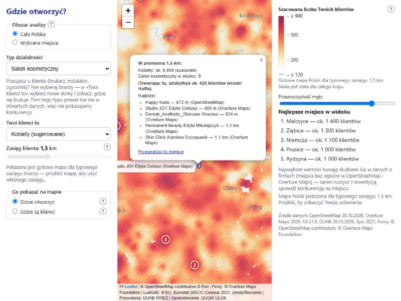 |

| Tryb „Wybrane miejsce” po „Przeanalizuj to miejsce” | Brukarz: bez branży, klienci = nowe domy (mapa Polski) |
|---|---|
| 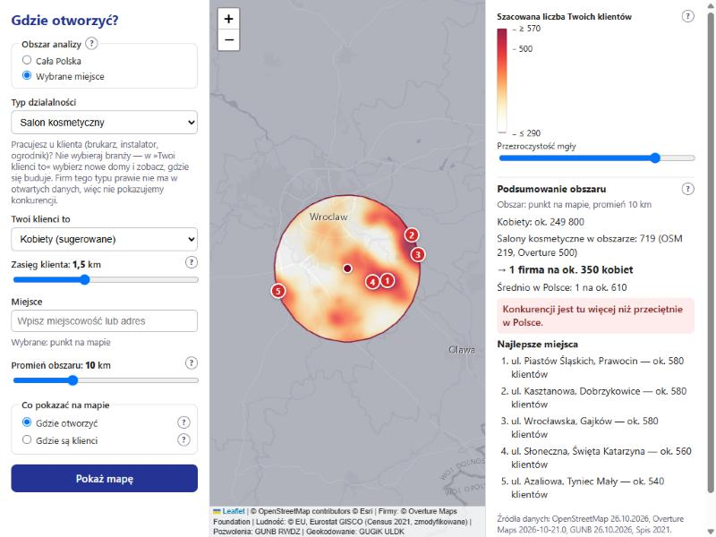 | 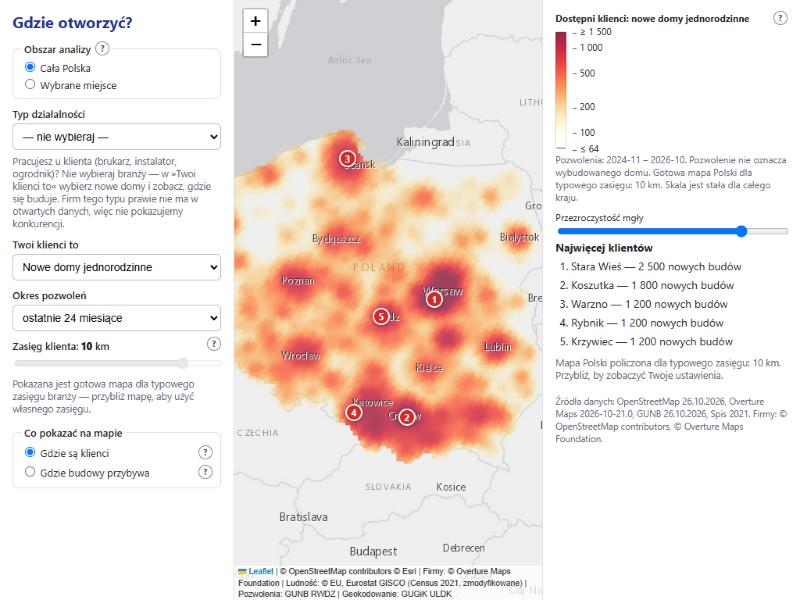 |

| Stary link z usuniętym typem (brukarstwo): działa, zostaje czynnik popytu | Telefon (375×812) |
|---|---|
| 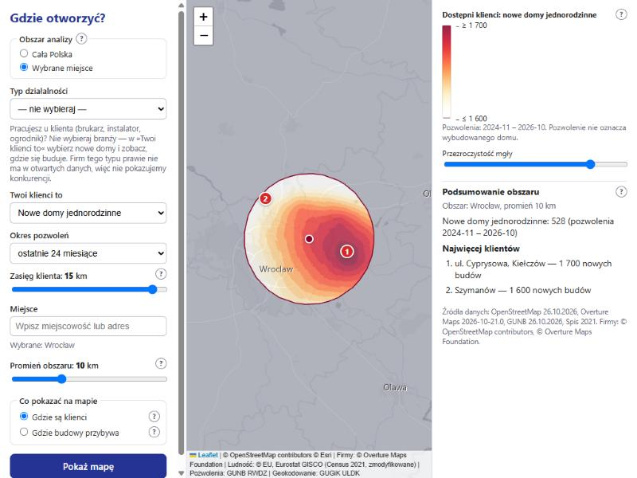 | 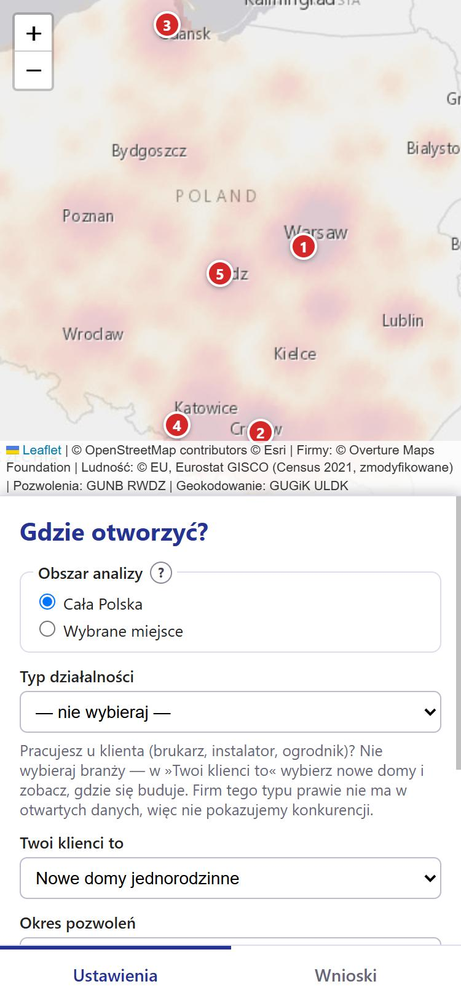 |

Zrzuty z wersji 3.3 (szare kreskowanie „mało danych o firmach”, Olsztynek vs Brzeg) są w `docs/screenshots/v33-*.png`.

Zrzuty z wersji 3.1 (okrąg wokół jednego miejsca, bez trybu „Cała Polska”) są w `docs/screenshots/v31-*.png`.

## Jak to działa (metoda)

Dla okręgu wokół wybranego miejsca serwer buduje **regularną siatkę** w metrach (lokalny układ metryczny wyrównany do północy; krok ok. promień/90, 50–300 m) i liczy na niej trzy wielkości. Każde źródło popytu *i* (komórka H3 z ludnością albo pozwoleniami, `d_i` osób) i każdy konkurent *k* (firma z OpenStreetMap albo Overture Maps) wpływa na punkt siatki *g* z wagą malejącą z odległością — **rozpad wykładniczy** `f(d) = exp(−d / zasięg)`, obcięty dla `d > 4·zasięg`:

```
Gdzie są klienci:  P(g) = Σ_i d_i · f(d_ig)
Gdzie są firmy:    K(g) = Σ_k f(d_kg)
Gdzie otworzyć:    E(g) = Σ_i d_i · f(d_ig) / ( f(d_ig) + C_i + A0 )     (model Huffa)
                   C_i  = Σ_k f(d_ik)   (siła istniejących konkurentów dla mieszkańca i),  A0 = exp(−1)
```

**Model Huffa (1963):** każdy mieszkaniec wybiera między firmami, a bliższa przyciąga go mocniej; `E(g)` to szacowana liczba klientów **nowej** firmy w punkcie *g*. **Opcja zewnętrzna `A0`** reprezentuje „inne możliwości” (firmy spoza obu baz, zakupy gdzie indziej) i częściowo kompensuje ich niekompletność. Wartości na siatce są zwracane przez `/api/surface`, a przeglądarka **interpoluje je** (×4, smoothstep) i dopiero potem koloruje — stąd gładka powierzchnia bez widocznych kwadratów. Po kliknięciu `/api/point` liczy dokładne liczby w okręgu zasięgu i ten sam wzór Huffa dla jednego punktu.

### Tryb „Cała Polska”: gotowa mapa + mapa na żywo (v3.2)

Ciągłe liczenie całej Polski przy każdym ruchu mapy było męczące (v2), więc robimy to **raz w ETL** (krok `national`, `etl/national.py`): dla środków komórek H3 **res 8** (~900 m między nimi; komórki z ludnością i ich sąsiedzi, ok. 420 tys. punktów) liczymy **te same wzory i funkcje co `/api/surface`** (Huff, potencjał popytu, zagęszczenie firm, trend budów; odległości w EPSG:2180) dla **typowego zasięgu**: z branżą — jej `bandwidth_km`, bez branży — `default_reach_km` czynnika (spis 1,5 km, pozwolenia 10 km). Warstw jest 92 (`open__{typ}__{czynnik}`, `rel__{typ}__{czynnik}` — patrz niżej, `comp__{typ}`, `demand__{czynnik}__{zasięg}`, `trend__{czynnik}`), w tabeli szerokiej `national_r8` (kolumna = warstwa). Grubsze poziomy `national_r7 … r5` powstają przez **maksimum z komórek-dzieci** — oddalona mapa pokazuje „najlepsze miejsce w tym rejonie”, a średnia zalałaby małe, dobre ośrodki mgłą bez kontrastu (dla trendu bierzemy wartość o największym module, ze znakiem). Tabela `national_meta` trzyma p5 i p99 wartości dodatnich: **stałą skalę kolorów** dla całego kraju (te same kolory znaczą te same liczby w Gdańsku i w Krakowie, i nie „pływają” przy przesuwaniu mapy).

`/api/national` wybiera rozdzielczość tak, by komórka H3 miała ≤ 4 px na ekranie (i nie więcej niż ~60 tys. komórek), układa wartości na siatce równej w rzucie Mercatora (żeby obraz przylegał do kafelków) i zwraca ją w tym samym kształcie co `/api/surface`, więc przeglądarka rysuje obie mgły tym samym kodem. Gdy dla wyboru nie ma gotowej warstwy (np. „Gdzie otworzyć” dla czynnika spoza zalecanych dla branży), odpowiedź mówi to w notatce, a użytkownik po przybliżeniu dostaje mapę na żywo. Mapa na żywo to `/api/surface` w trybie prostokąta widoku (`west,south,east,north`, bok ≤ 60 km): liczymy okrąg opisany na widoku, a maskę przycinamy do prostokąta, więc podsumowanie dotyczy „widocznego obszaru”.

### Wybór obszaru gestem (v3.4)

Zamiast formularza „miejsce + promień + Pokaż mapę” obszar wskazuje się na mapie. **Kliknięcie** tworzy *wybór*: pinezkę, przerywany okrąg podglądu i kartę (Leaflet `popup` z własnymi przyciskami) z liczbami punktu z `/api/point`, suwakiem promienia (jedna wartość w stanie, dwa widoki: karta i lewy panel) i przyciskiem ✓. **Prostokąt** rysuje się po kliknięciu „▭ Prostokąt”: wtedy `map.dragging.disable()`, a przeciągnięcie (**Pointer Events** — jeden kod dla myszy, palca i rysika) rysuje ramkę; po puszczeniu przesuwanie mapy wraca. Przycisk zamiast „przeciągnij gdziekolwiek” jest po to, żeby zwykłe przeciągnięcie (zwłaszcza palcem) dalej przesuwało mapę. Rogi to cztery przeciągalne markery (`divIcon`, 28 px na dotyk); ciągnięty róg zmienia prostokąt, a przeciwległy stoi w miejscu (przeciągnięcie „przez” niego odwraca prostokąt, nic się nie psuje). ✓ wysyła `/api/surface?area=rect&west=…&south=…&east=…&north=…`: serwer liczy tym samym kodem co „widoczny obszar” z v3.2, ale z gęstszą siatką (`divisions=90`), a podsumowanie nazywa się „Zaznaczony obszar: 12,7 × 8,2 km”. Limity boku to 0,6 km (rozdzielczość ludności ~300 m) i 60 km (jak dla widoku). Animacja wprowadzająca (`frontend/js/intro.js`) to czysty CSS (`@keyframes`) plus inline SVG; `prefers-reduced-motion` wyłącza ruch.

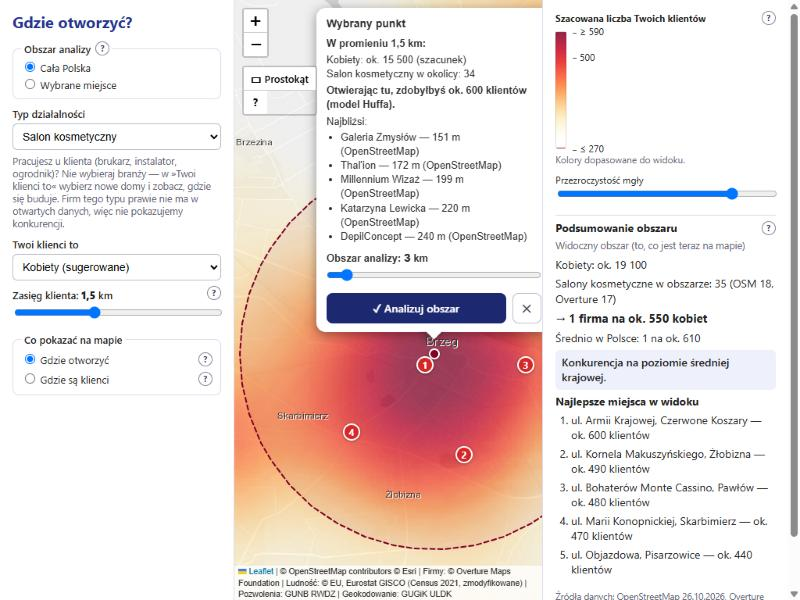

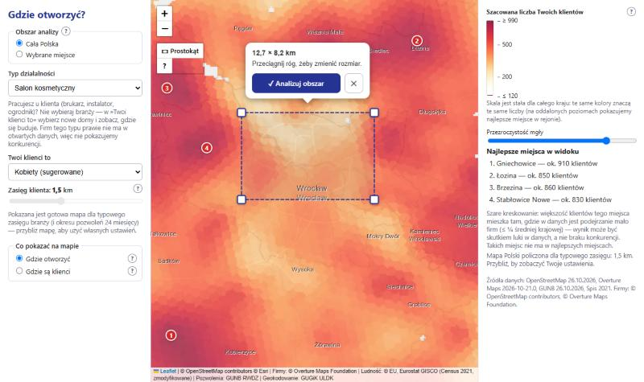

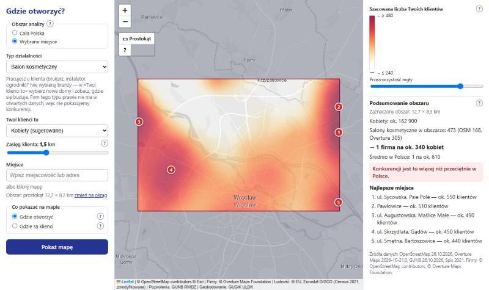

### „Mało danych o firmach” — szare kreskowanie (v3.3)

Model Huffa wierzy danym. W miasteczku, w którym w OSM i Overture nie ma **ani jednego salonu**, „nowa firma zgarnia wszystkie klientki” — a to najczęściej luka w danych, nie okazja (przy takiej liczbie mieszkańców statystycznie byłoby ok. 4–6 salonów). Przed v3.3 na mapie Polski wygrywały więc Olsztynek, Sianów czy Nowe. Krok ETL **`gaps`** (`etl/gaps.py`) wykrywa takie miejsca, **osobno dla każdego typu firmy**:

```
oczekiwane = (mieszkańcy w promieniu 2 km od środka komórki res 9) × (firm tego typu w Polsce / mieszkańców Polski)
w danych   = firm tego typu (tabela poi) w promieniu 2 km
luka       = oczekiwane ≥ 3  ORAZ  w danych ≤ 0,25 · oczekiwane
```

- **Dlaczego 2 km, ≥ 3, ¼:** 2 km to promień małego miasta; poniżej 3 „oczekiwanych” firm brak firm bywa prawdziwy (wieś), więc nie oceniamy; „najwyżej ¼ średniej krajowej” to różnica, której nie tłumaczy specyfika miasteczka (miasteczka mają średnio *więcej* salonów na mieszkańca niż średnia krajowa — [docs/kompletnosc-danych.md](docs/kompletnosc-danych.md)). Progi ustalono pomiarem (w lukach mieszka 1,7% ludności dla salonów, 0,9% dla fryzjerów, 0,4% dla sklepów spożywczych; Brzeg, Oława i Wrocław bez luk) i są stałymi `GAP_*` w `backend/app/catalog.py`.
- **Udział klientów z luki:** drugi przebieg Huffa z wagami `d_i · luka_i` (ta sama dostępność konkurencji `C_i`) daje `E_luka`; **wiarygodni klienci** to `rel = E − E_luka`. Dla źródeł popytu w res < 9 (zasięg > 2 km) `luka_i` to udział ludności komórek-dzieci res 9 w luce (tabela `gap_share`).
- **Co widać:** kolor mgły się **nie zmienia** (model mówi, co mówi), ale miejsca, w których ponad połowa klientów mieszka w lukach (`rel < ½ E`), mają **szare ukośne kreskowanie**. Takie miejsca **nie trafiają do najlepszych miejsc** (top-5 jest sortowany po `rel`; pokazywana liczba to nadal `E` jak w dymku). Dymek po kliknięciu i podsumowanie obszaru pokazują ostrzeżenie z liczbami („w danych 0, a przy tej liczbie mieszkańców średnio w Polsce byłoby ok. 6”), a werdykt „mniej konkurencji niż przeciętnie” zastępuje „nie da się ocenić — za mało danych o firmach”.
- **Gdzie działa:** warstwa „Gdzie otworzyć” w obu trybach (`/api/national` czyta kolumny `rel__…`, `/api/surface` liczy `E` i `E_luka` jednym przebiegiem po parach punkt–źródło).
- **Ograniczenie:** miejscowość, w której spodziewamy się < 3 firm (np. 3-tysięczne miasteczko i salony), nie jest oceniana — przy tak małych liczbach brak firm może być prawdziwy, więc tam kreskowania nie będzie. Warstwa „Gdzie są firmy” (sam typ, bez popytu) na razie bez kreskowania. Wykrywamy tylko luki *względem średniej krajowej* — jeśli dane o firmach są słabe wszędzie podobnie, nic nie wychwycimy.

Najważniejsze decyzje metodyczne (szczegółowo w [docs/sciaga-do-obrony.md](docs/sciaga-do-obrony.md)):

- **Metoda dasymetryczna:** ludność ze spisu (kwadraty 1 km, EPSG:3035) rozkładamy na heksagony H3 **res 9** (~0,1 km²) proporcjonalnie do wagi budynków mieszkalnych z OSM (powierzchnia × kondygnacje × współczynnik typu); przy dużym zasięgu źródła są grubsze (res 8/7), żeby było szybko.
- **Powierzchnia ciągła zamiast heksagonów/choropletu:** wartości zmieniają się płynnie, więc pokazujemy izopletę-mgłę; drobne komórki dopiero po kliknięciu.
- **Skala logarytmiczna YlOrRd z przezroczystością:** kolor zależy od wartości (górna granica = 99. percentyl wartości dodatnich w okręgu, dolna = 5. percentyl, ale nie niżej niż 1/100 górnej — skala obejmuje najwyżej 2 rzędy wielkości, żeby mapa nie była cała czerwona), małe wartości są przezroczyste.
- **Firmy z dwóch źródeł (Overture Maps + OSM):** OSM ma dla usług kilka razy mniej firm niż Overture (we Wrocławiu 340 salonów kosmetycznych w OSM wobec ok. 1 260 w Overture), więc `poi` = OSM ∪ Overture. Ten sam salon bywa w obu bazach, dlatego **deduplikacja przestrzenna**: obiekt Overture odpada, gdy w ≤ 50 m jest punkt OSM tego samego typu albo w ≤ 150 m punkt o podobnej nazwie (`difflib`, próg 0,6).
- **Podsumowanie i porównanie ze średnią krajową (normalizacja per capita):** surowa liczba firm nic nie mówi (duże miasto ma ich więcej), więc liczymy **klientów na jedną firmę** w okręgu i porównujemy z tym samym wskaźnikiem dla całej Polski. Powyżej 125% średniej → „mniej konkurencji niż przeciętnie”, poniżej 80% → „więcej”, w środku → „na poziomie średniej”.
- **Mapa trendu (zmiana w czasie):** dla czynników z pozwoleń liczymy różnicę „ostatnie 12 miesięcy minus poprzednie 12” (okno względem najnowszych danych), też z rozpadem odległości; paleta **rozbieżna** (niebieski = ubywa, czerwony = przybywa, zero przezroczyste), bo zmiana ma znak.
- **Rozdzielczość danych a sensowny zasięg:** ludność mamy w komórkach H3 res 9 (~300 m między środkami), więc zasięg poniżej 0,3 km nie dodaje informacji — suwak zaczyna się od 0,3 km.
- **Nazwy ulic w top-5:** z pliku OSM stawiamy punkty co ok. 100 m wzdłuż nazwanych dróg; nazwa miejsca = najbliższa ulica (≤ 150 m) + osiedle/miejscowość.
- **Odległości w metrach** (lokalny układ metryczny wokół miejsca, a dla danych EPSG:2180), nie w stopniach; bufor `4·zasięg` wokół okręgu usuwa efekt krawędzi.
- **Top-5** z odstępem ≥ max(zasięg, promień/5) (non-maximum suppression), tylko w okręgu; w widoku całej Polski odstęp to 1/6 szerokości widoku, a nazwą jest najbliższa miejscowość (bez ulic).
- **Uczciwy katalog branż (v3.2):** firmy pracujące u klienta (brukarz, ogrodnik, okna, kuchnie, instalator) znikły z listy „Typ działalności”: w OSM i Overture jest ich o rząd wielkości mniej niż w rzeczywistości ([docs/kompletnosc-danych.md](docs/kompletnosc-danych.md)), więc „mało konkurencji” znaczyłoby tylko „mało wpisów w bazach”. Czynniki popytu „nowe domy” zostają — brukarz wybiera klientów „nowe domy” bez branży i widzi, gdzie się buduje (także trend). ETL nadal zbiera te firmy do `poi` (`HIDDEN_TYPES`) pod przyszłe CEIDG.
- **Geokodowanie obrębów ewidencyjnych** (ULDK GUGiK) dla pozwoleń na budowę — dokładność do obrębu, stąd minimalny zasięg 1 km dla nowych domów.

## Zasady wizualizacji, z których korzystamy

- **Shneiderman (1996), „The Eyes Have It”:** *overview first, zoom and filter, then details-on-demand* → przepływ: wybór miejsca i promienia (zawężenie) → mapa okolicy (przegląd) → klik (szczegóły).
- **Huff (1963), „A Probabilistic Analysis of Shopping Center Trade Areas”** (używany też w ArcGIS Business Analyst) → liczba klientów nowej firmy zamiast surowego popytu.
- **Mapy izoplet / powierzchni ciągłej zamiast choropletów i hexbinów** dla wartości zmieniających się płynnie (mniej artefaktów granic, brak efektu MAUP w rysunku).
- **Borland & Taylor (2007), „Rainbow Color Map (Still) Considered Harmful”** i **Brewer, ColorBrewer** → sekwencyjna, jednobarwna skala YlOrRd, nie tęcza.
- **Skala logarytmiczna** dla skośnych rozkładów, **przezroczystość** małych wartości (efekt mgły, widać podkład i etykiety).
- **xkcd 1138 („Heatmap”)** — ostrzeżenie: mapa „tylko ludności” niczego nie wyjaśnia; stąd główna mapa odpowiada na pytanie „ilu klientów zdobędę”.
- Odrzucone: mapa dwuwymiarowa (bivariate) — trudna w odczycie; wtyczka Leaflet.heat — sumuje punkty w pikselach ekranu, więc obraz zależy od przybliżenia i nie odpowiada liczbom.

## Źródła danych i licencje

| Dane | Źródło | Licencja / atrybucja |
|---|---|---|
| Ludność (siatka 1 km, spis 2021) | Eurostat GISCO, Census GRID 2021 (V3) | © EU, Eurostat GISCO — dane zmodyfikowane (agregacja do H3) |
| Firmy, ulice i nazwy miejsc | OpenStreetMap (ekstrakt Geofabrik `poland-latest.osm.pbf`) | ODbL, © OpenStreetMap contributors |
| Firmy (drugie źródło) | Overture Maps Foundation, Places (wydanie 2026-10-21.0) | CDLA Permissive 2.0, © Overture Maps Foundation |
| Nowe budowy | GUNB — Rejestr Wniosków, Decyzji i Zgłoszeń (RWDZ), pliki CSV | dane publiczne GUNB |
| Granice obrębów | GUGiK ULDK | dane publiczne GUGiK |
| Podkład mapy | Esri World Light Gray (kafelki) | © Esri i współtwórcy |
| Wyszukiwarka adresów | Nominatim (OpenStreetMap) | ODbL; zapytania z limitem 1/s i pamięcią podręczną |

Podkład: pierwotnie planowano CARTO Positron, ale darmowe kafelki CARTO wymagają teraz klucza API, dlatego użyto jasnoszarego podkładu Esri (osobna warstwa podkładu i etykiet).

## Architektura

```
            (raz + odświeżanie)                                     (na żądanie)
 ┌────────────── ETL (Python) ───────────────┐      ┌──────── Backend FastAPI ────────┐     ┌──── Frontend ────┐
 │ Eurostat Census GRID 2021 → hex_pop_r9     │      │ /api/catalog                    │     │ index.html       │
 │ Geofabrik poland.osm.pbf  → poi, places,   │ ───▶ │ /api/surface (mgła: siatka,     │ ──▶ │ Leaflet          │
 │   streets, building_weights (dasymetria)   │DuckDB│   Huff, podsumowanie, trend,    │ JSON│ (bez buildowania)│
 │ Overture Places (S3)      → poi (dedup.)   │ plik │   top-5)                        │     │                  │
 │ GUNB RWDZ CSV + ULDK      → permits        │      │ /api/point (dymek punktu)       │     │                  │
 │ agregacja do H3 res 9 → 8 → 7 → 6 → 5      │      │ /api/national (gotowa mapa PL)  │     │                  │
 │ gaps: luki w danych o firmach (res 9 → 6)  │      │ /api/poi /api/geocode /api/meta │     │                  │
 │ national: Huff dla całej Polski (res 8,    │      │                                 │     │                  │
 │   piramida max → 7, 6, 5, stała skala)     │      │                                 │     │                  │
 └────────────────────────────────────────────┘      └─────────────────────────────────┘     └──────────────────┘
```

Dlaczego ETL zamiast zapytań na żywo: publiczne Overpass API blokuje automatyczne zapytania, a ULDK odpowiada ~0,35 s na działkę. Dane pobieramy hurtowo z otwartych plików i przetwarzamy raz do pliku DuckDB (`data/app.duckdb`) — backend tylko liczy na gotowych tabelach.

Struktura repozytorium:

```
backend/app/        FastAPI: main.py, config.py, db.py, catalog.py, api/routes.py,
                    analysis/{kernel,surface,service,layers,national}.py, services/geocode.py
etl/                download.py, osm_poi.py, overture.py, streets.py, buildings.py, population.py, permits.py,
                    geocode_obreby.py, aggregate.py, gaps.py, national.py, meta.py, run_all.py, sanity.py
frontend/           index.html, css/style.css, js/{app,api,map,ui,colors,intro}.js
tests/              pytest (małe fixture'y, baza testowa budowana w locie)
docs/               specyfikacja, plan, źródła danych, raport ETL, ściąga do obrony
```

## Instalacja i uruchomienie (Windows 11)

Wymagania: Windows 11, ≥ 16 GB RAM, ≥ 20 GB wolnego dysku, dostęp do internetu (jednorazowo ~3 GB danych).

```powershell
winget install --id=astral-sh.uv -e      # menedżer Pythona (po instalacji otwórz nową powłokę)
uv sync                                   # Python 3.13 + biblioteki (środowisko .venv)
uv run python -m etl.run_all              # ETL: pobieranie i przetwarzanie danych (kilka godzin, jednorazowo; budynki OSM ok. 16 min, luki w danych ok. 2 min, gotowa mapa Polski ok. 12 min)
uv run python -m etl.sanity               # kontrola jakości danych (powinno wypisać OK)
start.bat                                 # serwer: http://localhost:8000
```

Uwagi:
- Używamy Pythona 3.13 zarządzanego przez `uv` (`.python-version`); systemowego Pythona nie trzeba instalować.
- ETL można przerwać i wznowić — pobieranie i geokodowanie są wznawialne, a krok `national` pomija policzone warstwy (po zmianie danych o firmach lub ludności użyj `--only aggregate,gaps,national --force`; ok. 15 min — `gaps` liczy się zawsze od nowa, ale warstwy `rel__…` w `national` odświeża dopiero `--force`). `--only buildings,population,aggregate` uruchamia wybrane kroki, `--force` wymusza ponowne wykonanie.
- Serwer i ETL nie mogą działać jednocześnie (blokada pliku DuckDB).
- Serwer ULDK (GUGiK) może po godzinie intensywnych zapytań zablokować połączenie (przekierowanie na stronę-pułapkę). Geokodowanie przerywa się wtedy z komunikatem; odczekaj i dokończ: `uv run python -m etl.run_all --only geocode,permits_hex,aggregate --force` (szczegóły i aktualny stan: [docs/raport-etl.md](docs/raport-etl.md)).
- Testy: `uv run pytest -v`.

## Dostęp z innego urządzenia przez Tailscale

Aplikacja działa na komputerze domowym; z laptopa (np. na uczelni) otwierasz ją przez prywatną sieć Tailscale.

1. Zainstaluj Tailscale na komputerze z aplikacją i na laptopie (https://tailscale.com/download), zaloguj oba tym samym kontem.
2. Na komputerze z aplikacją zezwól na ruch przychodzący na port 8000 w Zaporze Windows (PowerShell jako administrator):
   `New-NetFirewallRule -DisplayName "Gdzie otworzyc 8000" -Direction Inbound -Protocol TCP -LocalPort 8000 -Action Allow -Profile Private`
   (sieć Tailscale ma zwykle profil „prywatny”; w razie problemów dodaj regułę dla interfejsu Tailscale).
3. Uruchom `start.bat` i na laptopie wejdź na `http://<nazwa-komputera>:8000` (nazwę widać w aplikacji Tailscale, działa MagicDNS).
4. Opcjonalnie publiczny link dla prowadzącego: `tailscale funnel 8000` (wyłącz po pokazie).

## Ograniczenia danych

- **OpenStreetMap i Overture Maps są niekompletne**, zwłaszcza dla małych usług, dlatego typów „pracujących u klienta” (brukarze, ogrodnicy, instalatorzy) nie oferujemy; dla typów o ocenie „medium” (barber, paznokcie, tatuaż, fitness) aplikacja ostrzega łagodniej. Overture wyraźnie uzupełnia salony, fryzjerów i markety, ale wynik „mało konkurencji” może nadal oznaczać „mało wpisów w bazach”; dla typów z oceną „poor” aplikacja ostrzega, że to głównie mapa popytu. Deduplikacja jest heurystyką (odległość + podobieństwo nazw) — część duplikatów może zostać, a część różnych firm w jednym budynku zostać połączona.
- **Luki w danych o firmach wykrywamy tylko tam, gdzie jest wyraźnie mniej firm niż średnio w Polsce** (≤ ¼ przy ≥ 3 oczekiwanych w promieniu 2 km). Małe miejscowości (oczekiwane < 3) nie są oceniane, a warstwa „Gdzie są firmy” nie ma kreskowania; kreskowanie ostrzega, ale nie uzupełnia brakujących firm (to zrobi dopiero CEIDG).
- **Spis ludności jest z 2021 r.**; uzupełniają go pozwolenia na budowę.
- **Pozwolenie na budowę ≠ wybudowany dom** (budowa trwa 1–3 lata, część nie rusza), a lokalizacja jest z dokładnością do obrębu ewidencyjnego (miasto: osiedle, wieś: cała wieś) — dlatego zasięg dla nowych domów wynosi co najmniej 1 km.
- **Ludność w heksagonach to szacunek modelowy** (metoda dasymetryczna): spis podaje tylko kwadraty 1 km, a rozkład wewnątrz kwadratu wynika z wag budynków OSM (nie znamy liczby mieszkań w budynku).
- **Kolory są względne dla okręgu i widoku na żywo** (gotowa mapa Polski ma skalę stałą dla kraju) (skala logarytmiczna dopasowana do wartości w wybranym obszarze), a liczby „klientów na firmę” bywają zawyżone, bo żadna baza nie zawiera wszystkich firm — dlatego porównujemy je ze średnią krajową liczoną tak samo.
- Liczba „nowych budynków wielorodzinnych” to liczba inwestycji, nie mieszkań (rejestr nie podaje liczby lokali).
- Wynik jest rankingiem pomocniczym, nie prognozą zysku.

## Plany rozwoju (poza zakresem tej wersji)

- **M7** hot-spoty Getis-Ord Gi\*,
- **M8** model ML „luki rynkowej” (gradient boosting, walidacja przestrzenna po województwach),
- **M9** integracja CEIDG jako trzecie źródło konkurencji (kody PKD są już w katalogu),
- **M10** dokładne geokodowanie działek dla ostatnich 24 miesięcy.

Dokumentacja: [specyfikacja v3](docs/superpowers/specs/2026-10-27-v3-mgla-huff-design.md), [plan v3](docs/superpowers/plans/2026-10-27-v3-mgla-huff.md), [plan v3.1 (Overture, podsumowanie, trend)](docs/superpowers/plans/2026-10-27-v31-overture-podsumowanie.md), [plan v3.2 (cała Polska)](docs/superpowers/plans/2026-10-28-v32-cala-polska.md), [plan v3.3 (mało danych o firmach)](docs/superpowers/plans/2026-10-28-v33-malo-danych.md), [plan v3.4 (wybór obszaru gestem)](docs/superpowers/plans/2026-10-28-v34-wybor-gestem.md), [kompletność danych](docs/kompletnosc-danych.md), [specyfikacja v1](docs/superpowers/specs/2026-10-26-gdzie-otworzyc-design.md), [specyfikacja v2](docs/superpowers/specs/2026-10-27-widok-dynamiczny-design.md), [plan v1](docs/superpowers/plans/2026-10-26-gdzie-otworzyc.md), [plan v2](docs/superpowers/plans/2026-10-27-widok-dynamiczny.md), [źródła danych](docs/zrodla-danych.md), [raport ETL](docs/raport-etl.md), [ściąga do obrony](docs/sciaga-do-obrony.md).
