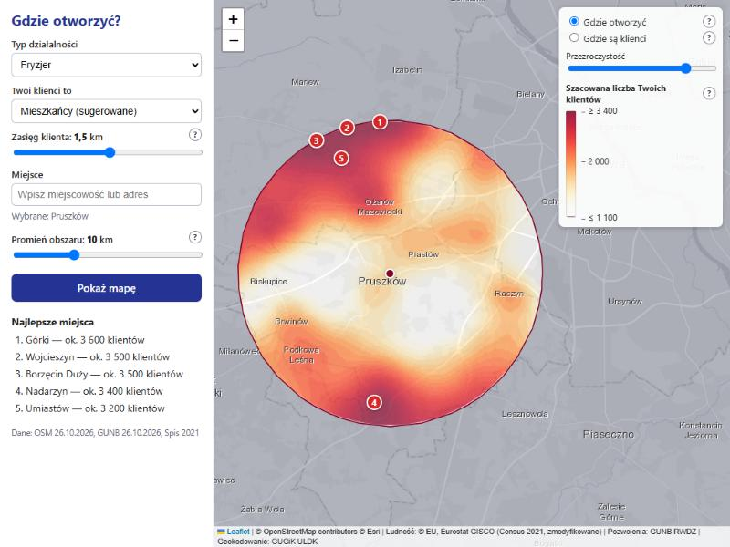
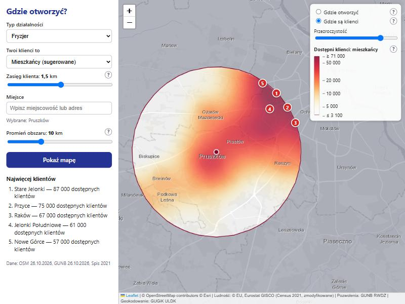
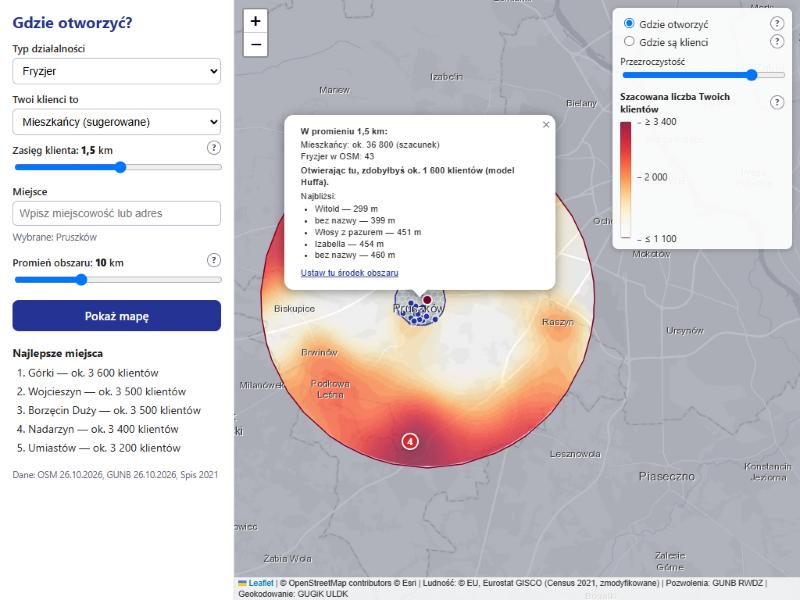
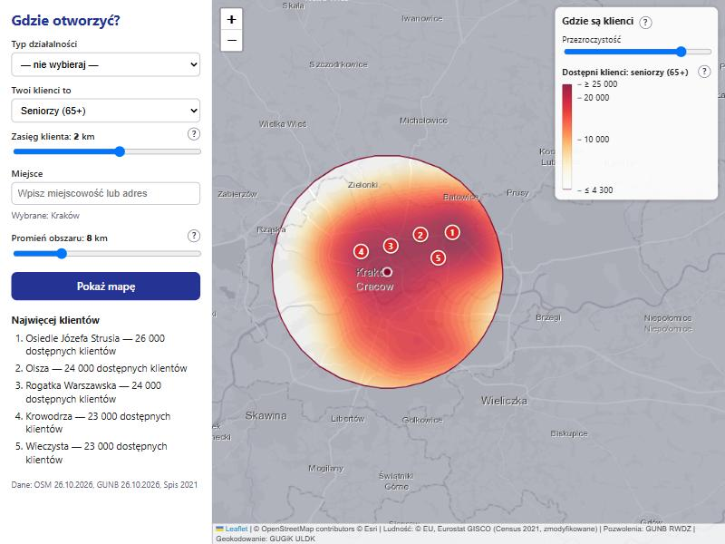
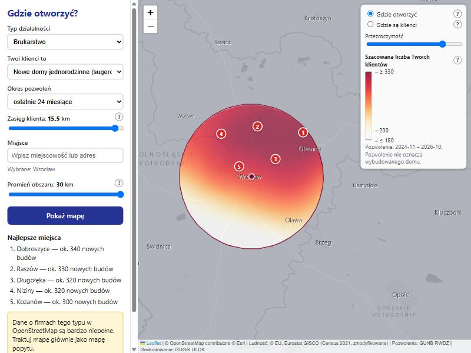
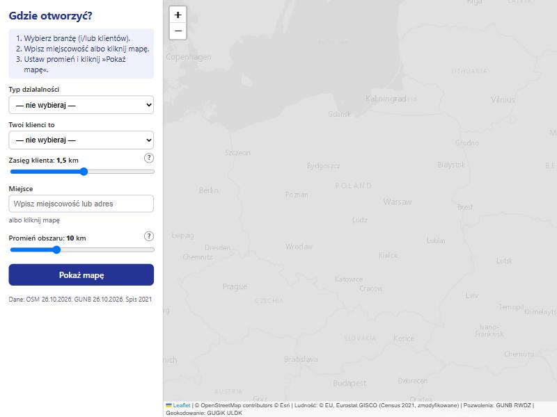
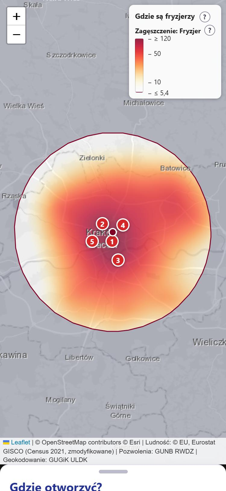

# Gdzie otworzyć? — mapa okazji biznesowych

Aplikacja webowa, która na mapie Polski pokazuje, **gdzie jest dużo potencjalnych klientów i mało konkurencji**. Projekt zaliczeniowy z przedmiotu „Analiza danych przestrzennych”.

Wybierasz typ działalności (16 typów) i/lub klientów (ludność ze spisu 2021 albo nowe domy z pozwoleń na budowę), **miejsce** (miejscowość albo klik na mapie), **promień obszaru** (1–30 km) i **zasięg klienta** (0,1–20 km), po czym klikasz „Pokaż mapę”. W okręgu wokół miejsca dostajesz **mgłę** — płynną żółto-czerwoną mapę — a kliknięcie w nią pokazuje szczegóły.



## Jak używać

1. **Wybierz branżę** („Typ działalności”) i/lub **klientów** („Twoi klienci to”); przy nowych domach wybierz okres pozwoleń.
2. **Podaj miejsce:** wpisz miejscowość albo kliknij mapę. Ustaw **promień obszaru** (1–30 km) i **zasięg klienta** (suwak logarytmiczny 0,1–20 km; fryzjer ok. 1,5 km, market budowlany 10–20 km).
3. Kliknij **„Pokaż mapę”**. Poza okręgiem mapa jest przygaszona, w okręgu widać mgłę, a w panelu top-5 miejsc. Zmiana ustawień przelicza mapę sama (po 300 ms); **ruch i przybliżanie mapy nie wysyłają żadnych zapytań**.
4. **Warstwy:** typ + klienci → przełącznik **„Gdzie otworzyć”** (szacowana liczba Twoich klientów, model Huffa) i **„Gdzie są klienci”**; tylko typ → **„Gdzie są {firmy}”**; tylko klienci → **„Gdzie są klienci”**. Pytajniki przy nazwach wyjaśniają warstwy.
5. **Kliknięcie w mapę** pokazuje szczegóły: okrąg zasięgu, drobne heksagony z ludnością, konkurentów i dymek („W promieniu 1,5 km: ok. 36 800 mieszkańców · Otwierając tu, zdobyłbyś ok. 1 600 klientów”) oraz link „Ustaw tu środek obszaru”. Zamknięcie dymku czyści szczegóły.
6. Adres strony (hash) zapisuje cały widok — link można wysłać i odtworzy tę samą mapę.

## Przykłady użycia

| Gdzie są klienci (ta sama okolica) | Szczegóły po kliknięciu |
|---|---|
|  |  |

| Tylko klienci: seniorzy, Kraków (bez przełącznika) | Brukarz pod Wrocławiem, promień 30 km, zasięg 15 km |
|---|---|
|  |  |

| Start (karta instrukcji) | Telefon (375×812) |
|---|---|
|  |  |

## Jak to działa (metoda)

Dla okręgu wokół wybranego miejsca serwer buduje **regularną siatkę** w metrach (EPSG:2180; krok ok. promień/90, 50–300 m) i liczy na niej trzy wielkości. Każde źródło popytu *i* (komórka H3 z ludnością albo pozwoleniami, `d_i` osób) i każdy konkurent *k* (firma z OSM) wpływa na punkt siatki *g* z wagą malejącą z odległością — **rozpad wykładniczy** `f(d) = exp(−d / zasięg)`, obcięty dla `d > 4·zasięg`:

```
Gdzie są klienci:  P(g) = Σ_i d_i · f(d_ig)
Gdzie są firmy:    K(g) = Σ_k f(d_kg)
Gdzie otworzyć:    E(g) = Σ_i d_i · f(d_ig) / ( f(d_ig) + C_i + A0 )     (model Huffa)
                   C_i  = Σ_k f(d_ik)   (siła istniejących konkurentów dla mieszkańca i),  A0 = exp(−1)
```

**Model Huffa (1963):** każdy mieszkaniec wybiera między firmami, a bliższa przyciąga go mocniej; `E(g)` to szacowana liczba klientów **nowej** firmy w punkcie *g*. **Opcja zewnętrzna `A0`** reprezentuje „inne możliwości” (firmy spoza OSM, zakupy gdzie indziej) i częściowo kompensuje niekompletność OSM. Wartości na siatce są zwracane przez `/api/surface`, a przeglądarka **interpoluje je** (×4, smoothstep) i dopiero potem koloruje — stąd gładka powierzchnia bez widocznych kwadratów. Po kliknięciu `/api/point` liczy dokładne liczby w okręgu zasięgu i ten sam wzór Huffa dla jednego punktu.

Najważniejsze decyzje metodyczne (szczegółowo w [docs/sciaga-do-obrony.md](docs/sciaga-do-obrony.md)):

- **Metoda dasymetryczna:** ludność ze spisu (kwadraty 1 km, EPSG:3035) rozkładamy na heksagony H3 **res 9** (~0,1 km²) proporcjonalnie do wagi budynków mieszkalnych z OSM (powierzchnia × kondygnacje × współczynnik typu); przy dużym zasięgu źródła są grubsze (res 8/7), żeby było szybko.
- **Powierzchnia ciągła zamiast heksagonów/choropletu:** wartości zmieniają się płynnie, więc pokazujemy izopletę-mgłę; drobne komórki dopiero po kliknięciu.
- **Skala logarytmiczna YlOrRd z przezroczystością:** kolor zależy od wartości (5.–99. percentyl wartości dodatnich w okręgu), małe wartości są przezroczyste.
- **Odległości w EPSG:2180** (układ metryczny dla Polski), nie w stopniach; bufor `4·zasięg` wokół okręgu usuwa efekt krawędzi.
- **Top-5** z odstępem ≥ max(zasięg, promień/5) (non-maximum suppression), tylko w okręgu.
- **Geokodowanie obrębów ewidencyjnych** (ULDK GUGiK) dla pozwoleń na budowę — dokładność do obrębu, stąd minimalny zasięg 1 km dla nowych domów.

## Zasady wizualizacji, z których korzystamy

- **Shneiderman (1996), „The Eyes Have It”:** *overview first, zoom and filter, then details-on-demand* → przepływ: wybór miejsca i promienia (zawężenie) → mapa okolicy (przegląd) → klik (szczegóły).
- **Huff (1963), „A Probabilistic Analysis of Shopping Center Trade Areas”** (używany też w ArcGIS Business Analyst) → liczba klientów nowej firmy zamiast surowego popytu.
- **Mapy izoplet / powierzchni ciągłej zamiast choropletów i hexbinów** dla wartości zmieniających się płynnie (mniej artefaktów granic, brak efektu MAUP w rysunku).
- **Borland & Taylor (2007), „Rainbow Color Map (Still) Considered Harmful”** i **Brewer, ColorBrewer** → sekwencyjna, jednobarwna skala YlOrRd, nie tęcza.
- **Skala logarytmiczna** dla skośnych rozkładów, **przezroczystość** małych wartości (efekt mgły, widać podkład i etykiety).
- **xkcd 1138 („Heatmap”)** — ostrzeżenie: mapa „tylko ludności” niczego nie wyjaśnia; stąd główna mapa odpowiada na pytanie „ilu klientów zdobędę”.
- Odrzucone: mapa dwuwymiarowa (bivariate) — trudna w odczycie; wtyczka Leaflet.heat — sumuje punkty w pikselach ekranu, więc obraz zależy od przybliżenia i nie odpowiada liczbom.

## Źródła danych i licencje

| Dane | Źródło | Licencja / atrybucja |
|---|---|---|
| Ludność (siatka 1 km, spis 2021) | Eurostat GISCO, Census GRID 2021 (V3) | © EU, Eurostat GISCO — dane zmodyfikowane (agregacja do H3) |
| Firmy i nazwy miejsc | OpenStreetMap (ekstrakt Geofabrik `poland-latest.osm.pbf`) | ODbL, © OpenStreetMap contributors |
| Nowe budowy | GUNB — Rejestr Wniosków, Decyzji i Zgłoszeń (RWDZ), pliki CSV | dane publiczne GUNB |
| Granice obrębów | GUGiK ULDK | dane publiczne GUGiK |
| Podkład mapy | Esri World Light Gray (kafelki) | © Esri i współtwórcy |
| Wyszukiwarka adresów | Nominatim (OpenStreetMap) | ODbL; zapytania z limitem 1/s i pamięcią podręczną |

Podkład: pierwotnie planowano CARTO Positron, ale darmowe kafelki CARTO wymagają teraz klucza API, dlatego użyto jasnoszarego podkładu Esri (osobna warstwa podkładu i etykiet).

## Architektura

```
            (raz + odświeżanie)                                     (na żądanie)
 ┌────────────── ETL (Python) ───────────────┐      ┌──────── Backend FastAPI ────────┐     ┌──── Frontend ────┐
 │ Eurostat Census GRID 2021 → hex_pop_r9     │      │ /api/catalog                    │     │ index.html       │
 │ Geofabrik poland.osm.pbf  → poi, places,   │ ───▶ │ /api/surface (mgła: siatka,     │ ──▶ │ Leaflet + h3-js  │
 │   building_weights (dasymetria)            │DuckDB│   Huff, top-5)                  │ JSON│ (bez buildowania)│
 │ GUNB RWDZ CSV + ULDK      → permits        │ plik │ /api/point (dymek punktu)       │     │                  │
 │ agregacja do H3 res 9 → 8 → 7 → 6 → 5      │      │ /api/poi /api/geocode /api/meta │     │                  │
 └────────────────────────────────────────────┘      └─────────────────────────────────┘     └──────────────────┘
```

Dlaczego ETL zamiast zapytań na żywo: publiczne Overpass API blokuje automatyczne zapytania, a ULDK odpowiada ~0,35 s na działkę. Dane pobieramy hurtowo z otwartych plików i przetwarzamy raz do pliku DuckDB (`data/app.duckdb`) — backend tylko liczy na gotowych tabelach.

Struktura repozytorium:

```
backend/app/        FastAPI: main.py, config.py, db.py, catalog.py, api/routes.py,
                    analysis/{kernel,surface,service}.py, services/geocode.py
etl/                download.py, osm_poi.py, buildings.py, population.py, permits.py,
                    geocode_obreby.py, aggregate.py, meta.py, run_all.py, sanity.py
frontend/           index.html, css/style.css, js/{app,api,map,ui,colors}.js
tests/              pytest (małe fixture'y, baza testowa budowana w locie)
docs/               specyfikacja, plan, źródła danych, raport ETL, ściąga do obrony
```

## Instalacja i uruchomienie (Windows 11)

Wymagania: Windows 11, ≥ 16 GB RAM, ≥ 20 GB wolnego dysku, dostęp do internetu (jednorazowo ~3 GB danych).

```powershell
winget install --id=astral-sh.uv -e      # menedżer Pythona (po instalacji otwórz nową powłokę)
uv sync                                   # Python 3.13 + biblioteki (środowisko .venv)
uv run python -m etl.run_all              # ETL: pobieranie i przetwarzanie danych (kilka godzin, jednorazowo; budynki OSM ok. 16 min)
uv run python -m etl.sanity               # kontrola jakości danych (powinno wypisać OK)
start.bat                                 # serwer: http://localhost:8000
```

Uwagi:
- Używamy Pythona 3.13 zarządzanego przez `uv` (`.python-version`); systemowego Pythona nie trzeba instalować.
- ETL można przerwać i wznowić — pobieranie i geokodowanie są wznawialne. `--only buildings,population,aggregate` uruchamia wybrane kroki, `--force` wymusza ponowne wykonanie.
- Serwer i ETL nie mogą działać jednocześnie (blokada pliku DuckDB).
- Serwer ULDK (GUGiK) może po godzinie intensywnych zapytań zablokować połączenie (przekierowanie na stronę-pułapkę). Geokodowanie przerywa się wtedy z komunikatem; odczekaj i dokończ: `uv run python -m etl.run_all --only geocode,permits_hex,aggregate --force` (szczegóły i aktualny stan: [docs/raport-etl.md](docs/raport-etl.md)).
- Testy: `uv run pytest -v`.

## Dostęp z innego urządzenia przez Tailscale

Aplikacja działa na komputerze domowym; z laptopa (np. na uczelni) otwierasz ją przez prywatną sieć Tailscale.

1. Zainstaluj Tailscale na komputerze z aplikacją i na laptopie (https://tailscale.com/download), zaloguj oba tym samym kontem.
2. Na komputerze z aplikacją zezwól na ruch przychodzący na port 8000 w Zaporze Windows (PowerShell jako administrator):
   `New-NetFirewallRule -DisplayName "Gdzie otworzyc 8000" -Direction Inbound -Protocol TCP -LocalPort 8000 -Action Allow -Profile Private`
   (sieć Tailscale ma zwykle profil „prywatny”; w razie problemów dodaj regułę dla interfejsu Tailscale).
3. Uruchom `start.bat` i na laptopie wejdź na `http://<nazwa-komputera>:8000` (nazwę widać w aplikacji Tailscale, działa MagicDNS).
4. Opcjonalnie publiczny link dla prowadzącego: `tailscale funnel 8000` (wyłącz po pokazie).

## Ograniczenia danych

- **OpenStreetMap jest niekompletny**, zwłaszcza dla małych usług (fryzjerzy, brukarze). Wynik „mało konkurencji” może oznaczać „mało wpisów w OSM”; dla typów z oceną „poor” aplikacja ostrzega, że to głównie mapa popytu.
- **Spis ludności jest z 2021 r.**; uzupełniają go pozwolenia na budowę.
- **Pozwolenie na budowę ≠ wybudowany dom** (budowa trwa 1–3 lata, część nie rusza), a lokalizacja jest z dokładnością do obrębu ewidencyjnego (miasto: osiedle, wieś: cała wieś) — dlatego zasięg dla nowych domów wynosi co najmniej 1 km.
- **Ludność w heksagonach to szacunek modelowy** (metoda dasymetryczna): spis podaje tylko kwadraty 1 km, a rozkład wewnątrz kwadratu wynika z wag budynków OSM (nie znamy liczby mieszkań w budynku).
- **Kolory są względne dla okręgu** (skala logarytmiczna dopasowana do wartości w wybranym obszarze), a liczby „klientów na firmę” są zawyżone, bo OSM ma ok. 1/3–1/4 firm — mapę czytamy porównawczo.
- Liczba „nowych budynków wielorodzinnych” to liczba inwestycji, nie mieszkań (rejestr nie podaje liczby lokali).
- Wynik jest rankingiem pomocniczym, nie prognozą zysku.

## Plany rozwoju (poza zakresem tej wersji)

- **M6** warstwa „Trend” dla budowlanki (ostatnie 12 mies. vs poprzednie 12),
- **M7** hot-spoty Getis-Ord Gi\*,
- **M8** model ML „luki rynkowej” (gradient boosting, walidacja przestrzenna po województwach),
- **M9** integracja CEIDG jako drugie źródło konkurencji (kody PKD są już w katalogu),
- **M10** dokładne geokodowanie działek dla ostatnich 24 miesięcy.

Dokumentacja: [specyfikacja v1](docs/superpowers/specs/2026-10-26-gdzie-otworzyc-design.md), [specyfikacja v2](docs/superpowers/specs/2026-10-27-widok-dynamiczny-design.md), [plan v1](docs/superpowers/plans/2026-10-26-gdzie-otworzyc.md), [plan v2](docs/superpowers/plans/2026-10-27-widok-dynamiczny.md), [źródła danych](docs/zrodla-danych.md), [raport ETL](docs/raport-etl.md), [ściąga do obrony](docs/sciaga-do-obrony.md).
